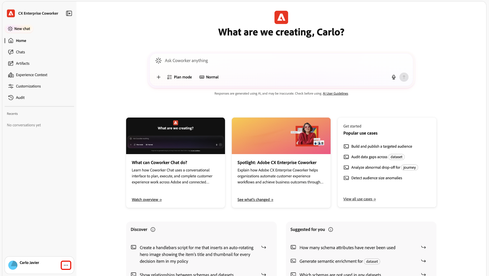

# Zugriffssteuerung für Kollegen {#access-control}

Verwenden Sie die Adobe CX Enterprise Coworker-Zugriffssteuerung, um zu verwalten, wer Coworker verwenden kann und welche Funktionen sie verwenden können.

Die Zugriffssteuerung gilt für Mitarbeiter sowohl in der rechten Leiste als auch im Vollbildmodus.

>[!NOTE]
>
>Die Zugriffssteuerung wird schrittweise für alle Kunden mit Coworker-Zugriff eingeführt. Möglicherweise wird [!UICONTROL Zugriffssteuerung] in Ihrer Organisation noch nicht angezeigt. Weitere Informationen finden Sie unter [Hilfe beim Zugriff erhalten](#get-help-with-access).

## Wie der Zugriff bestimmt wird {#how-access-is-determined}

Der Zugriff durch Kollegen wird durch eine organisationsweite Einstellung und optionale Benutzer- oder Gruppenüberschreibungen gesteuert. Die Einstellung Unternehmensweit ermöglicht oder deaktiviert den Zugriff durch Kollegen für Benutzende in Ihrer Organisation. Der Zugriff ist standardmäßig für alle aktiviert.

| Einstellung | Auswirkungen auf den Zugriff |
| --- | --- |
| Organisationsweite Einstellung | Aktivieren Sie den Zugriff durch Kollegen für alle oder deaktivieren Sie ihn für Ihre Organisation. |
| Außerkraftsetzung durch Benutzer oder Benutzergruppe | Überschreibungen geben Admins die Kontrolle über den Zugriff von Kollegen für bestimmte Benutzende oder Benutzergruppen. |
| Kompatible Anwendungsberechtigungen | Die Zugriffssteuerung für Mitarbeiter legt fest, ob Sie auf allgemein verfügbare Funktionen von Kollegen zugreifen können. Coworker erbt Ihre Benutzerberechtigungen von Coworker-kompatiblen CX Enterprise-Anwendungen und berücksichtigt die Berechtigungen, die jede Anwendung bereits erzwingt. |

## Mitarbeiter-Administratoren {#add-coworker-admins}

Ein Mitarbeiter-Administrator ist ein Benutzer, der entweder als **[!UICONTROL Systemadministrator]** für das Unternehmen oder als **[!UICONTROL Produktadministrator]** von [!DNL Adobe Experience Platform] in [!DNL Adobe Admin Console] zugewiesen ist.

## Verwalten des Benutzerzugriffs {#manage-user-access}

Verwenden Sie [!UICONTROL Zugriffssteuerung] in Coworker, um den Zugriff für Einzelpersonen oder Benutzergruppen zu verwalten.

>[!NOTE]
>
>Wählen Sie bis zu 100 Benutzer oder Benutzergruppen pro Massenaktion aus. Beim Exportieren von Benutzenden umfasst der Export nur geladene Benutzende.

1. Öffnen Sie das Coworker-Erlebnis. Anweisungen finden Sie unter [Bei Kollegen anmelden](/help/chat/ui-guide.md#sign-in).
1. Öffnen Sie das Profilmenü und wählen Sie **[!UICONTROL Admin-Einstellungen]**.

   

   

1. Wählen Sie **[!UICONTROL Zugriffssteuerung]** aus.

   

   In diesem Video erfahren Sie, wie Sie Kollegen verwalten.

   >[!VIDEO](https://video.tv.adobe.com/v/3507151?learn=on){transcript=true}

1. Wählen Sie **[!UICONTROL Benutzer]** aus, um den individuellen Zugriff zu verwalten, oder **[!UICONTROL Benutzergruppen]**, um den Gruppenzugriff zu verwalten. Eine Benutzergruppeneinstellung gilt für ihre Mitglieder.

   Die Benutzergruppen der Kollegen sind von den [!DNL Adobe Admin Console] Gruppen getrennt. Das Synchronisieren von Benutzergruppen von [!DNL Adobe Admin Console] mit einem Kollegen ist in Kürze verfügbar.

   Die Benutzerliste enthält Benutzer in Ihrer Organisation. Der Zugriff durch Kollegen ist für diese Benutzer standardmäßig aktiviert.

   * **Aktiviert:** Der Benutzer oder die Benutzergruppe ist aktiv.
   * **Deaktiviert:** Der Benutzer oder die Benutzergruppe ist inaktiv.

   Wenn der Zugriff für alle deaktiviert ist, aktivieren Sie **[!UICONTROL Überschreibungen zulassen]** und wählen Sie **[!UICONTROL Überschreibung hinzufügen]** aus, um Benutzer oder Gruppen hinzuzufügen, die weiterhin Zugriff haben sollten.

## Berechtigungen in Coworker-kompatiblen CX Enterprise-Anwendungen {#permissions-in-compatible-applications}

Mit Kollegen kompatible CX Enterprise-Anwendungen erzwingen weiterhin ihre eigenen Berechtigungen.

Der Mitarbeiter respektiert die Berechtigungen in kompatiblen Anwendungen. Wenn Sie beispielsweise nicht auf einen Datensatz in [!DNL Adobe Experience Platform] zugreifen können, kann ein Mitarbeiter diesen Datensatz nicht für Sie abrufen oder bearbeiten.

## Hilfe zum Zugriff {#get-help-with-access}

Wenn Sie &quot;[!UICONTROL &quot; nicht sehen] wenden Sie sich an Ihren Adobe-Administrator oder den Adobe-Support. Er kann bestätigen, ob die Funktion für Ihr Unternehmen aktiviert ist und ob Sie Zugriff auf die Einstellungen haben.

Wenn Ihnen der Zugriff verweigert wird, bitten Sie Ihren Administrator, die organisationsweite Standardeinstellung sowie alle Benutzer- oder Gruppeneinstellungen zu überprüfen. Bitten Sie die Mitarbeiter bei einem kompatiblen CX Enterprise-Programm, die für dieses Programm separat verwalteten Berechtigungen zu überprüfen.

## Weitere Hilfe zu diesem Thema {#more-help}

Verwenden Sie diese Ressourcen, um weitere Informationen über Mitarbeiter und Administration zu erhalten.

* [Coworker Chat - Übersicht](/help/chat/overview.md)
* [Erste Schritte mit dem Coworker Chat](/help/chat/ui-guide.md)
* [Verwalten von Plug-ins und Marketplaces](/help/customizations/plugins/manage-plugins-for-your-org.md)
