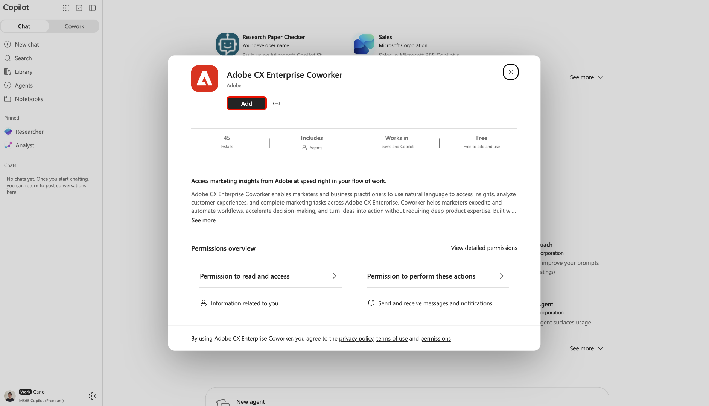
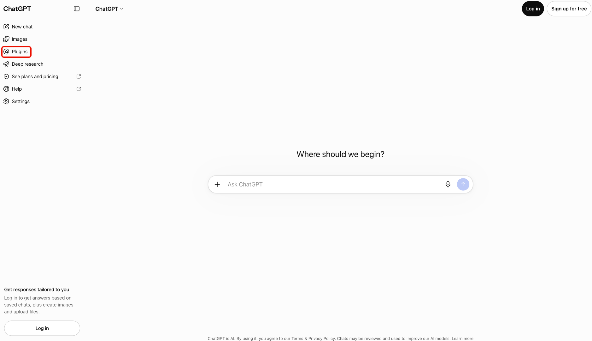
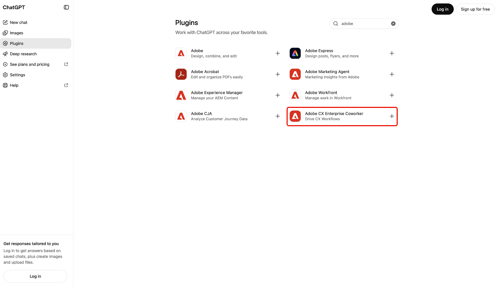

# Adobe CX Enterprise Coworker für KI-Plattformen

Verwenden Sie Adobe CX Enterprise Coworker für KI-Plattformen, um Marketing-Einblicke in die bereits verwendeten KI-Tools zu erhalten. Stellen Sie Fragen in natürlicher Sprache, ohne das Werkzeug zu wechseln. Suchen Sie in jeder Plattform das Produkt, das als Adobe CX Enterprise Coworker aufgeführt ist.

Verfügbare Plattformen und deren Setup-Anweisungen finden Sie unter [Einrichten von ](#set-up-coworker)&quot;.

Die Verwendung von Coworker in KI-Plattformen verursacht keine zusätzlichen Kosten. Sie ist in Ihrer CX Enterprise Coworker-Lizenz enthalten und die Nutzung erfolgt über dieselben KI-Credits wie bei anderen Coworker-Funktionen. Weitere Informationen finden Sie unter [Nutzung von Adobe Experience Platform-Agentenvorgängen und KI-Guthaben](https://experienceleague.adobe.com/de/docs/cx-enterprise-ai/experience-cloud-ai/overview/ai-credit-consumption){target="_blank"}.

<!-- TODO: architecture diagram pending from engineering. KT page notes "to be provided on 8/28"; still outstanding as of 8/31. Insert here once received. -->

## Voraussetzungen {#prerequisites}

Bevor Sie Coworker in einer KI-Plattform verwenden können, vergewissern Sie sich, dass Sie Folgendes tun.

* Adobe CX Enterprise Coworker für Ihr Unternehmen und Ihren eigenen Zugriff darauf in Adobe bereitgestellt.
* Adobe Experience Platform und mindestens eines von Adobe Real-Time CDP, Adobe Journey Optimizer oder Adobe Customer Journey Analytics.
* Zugriff auf eine KI-Plattform, die unter &quot;[ einrichten“ aufgeführt ](#set-up-coworker).

## Datenzugriff und Berechtigungen {#data-access-and-permissions}

Die Coworker in KI-Plattformen spiegeln dieselbe Daten- und Zugriffsebene wider, die mit Ihrer Adobe-Identität verknüpft ist. Was Sie abfragen und sehen können, stimmt mit dem überein, wozu Sie bereits in Experience Platform und den zugehörigen Lösungen berechtigt sind. Der -Kollege erbt diese Berechtigungen, sodass für die KI-Plattformintegration keine separaten Berechtigungen eingerichtet werden müssen. Der -Mitarbeiter gibt schreibgeschützte Einblicke zurück und ändert Ihre Kundendaten nicht. Überprüfen Sie alle generierten Zusammenfassungen und Analysen, bevor Sie sie für geschäftliche Entscheidungen verwenden.

<!-- Confirmed by PM (Siddhartha Srivastava) on 2026-09-02 for Microsoft 365 Copilot, Claude, and ChatGPT. Validate this permissions model for each additional platform before adding its setup section. -->

## Wichtige Anwendungsfälle {#key-use-cases}

Verwenden Sie Coworker in KI-Plattformen, um gängige Marketing-Workflows zu beschleunigen, ohne Ihre alltäglichen Tools verlassen zu müssen.

| Anwendungsfall | Beschreibung |
| --- | --- |
| Kampagnen planen und überprüfen | Planen Sie Kampagnen, einschließlich Partnerkampagnen-Reviews und Zielgruppen-Prognosen. Vergleichen Sie die Leistung von Campaign im Zeitverlauf und ermitteln Sie, welche Touchpoints für Konversionen verantwortlich sind. |
| Überwachen der Bereitschaft von Journey und Kampagnen | Überprüfen und überwachen Sie aktive Kampagnen, analysieren Sie Journey von Kunden und bewerten Sie die Kampagnenbereitschaft. Verfolgen Sie die Journey-Performance und die Abbrüche, um Optimierungsmöglichkeiten zu identifizieren. |
| Abrufen operativer Einblicke | Identifizieren Sie, welche Zielgruppen am größten sind oder am stärksten interagieren, damit Sie Prioritäten setzen können, worauf Sie Ihre Bemühungen konzentrieren müssen, und verfolgen können, wie Ihre Segmente im Laufe der Zeit wachsen oder schrumpfen. |
| Workflows und Inhalte optimieren | Optimieren Sie Workflows und identifizieren Sie Asset- und Inhaltsanforderungen für CX-Kampagnen. Visuelle Berichte zur Kampagnenleistung generieren, ohne Abfragen oder Dashboards manuell zu erstellen. |
| Schnellere Zusammenarbeit und Entscheidung | Verwenden Sie empfohlene Eingabeaufforderungen, um Zielgruppen, Kampagnen und Web-Traffic zu untersuchen. Teilen Sie Einblicke mit Ihrem Team während Planungsbesprechungen und beantworten Sie Ad-hoc-Fragen in Echtzeit, während Sie Pläne oder Decks überprüfen. |

<!-- Use cases approved by PM Siddhartha Srivastava on 2026-08-31 and confirmed for Microsoft 365 Copilot, Claude, and ChatGPT on 2026-09-02. Validate applicability for each additional platform before adding its setup section. -->

## Einrichten eines Kollegen {#set-up-coworker}

Eine verfügbare Plattform für Einrichtungsanweisungen auswählen. Nach dem Setup versuchen Sie Folgendes [Beispielaufforderungen](#example-prompts).

* [Microsoft 365 Copilot](#microsoft-365-copilot)
* [ChatGPT](#chatgpt)
* [Claude](#claude)
* [Gemini Enterprise](#gemini-enterprise)
* [Amazon Quick](#amazon-quick)
* [IBM watsonx Orchestrate](#ibm-watsonx-orchestrate)
* [Databricks](#databricks)

### [!DNL Microsoft 365 Copilot] {#microsoft-365-copilot}

Verwenden Sie [!DNL Adobe CX Enterprise Coworker for Copilot], um Marketing-Einblicke in [!DNL Microsoft 365 Copilot] zu erhalten.

Bevor Sie beginnen, bestätigen Sie, dass Sie Zugriff auf [!DNL Microsoft 365 Copilot] haben.

#### Einrichten des Unternehmenszugriffs {#copilot-organization-setup}

Ein Administrator muss diese Schritte ausführen, damit die Endbenutzer in [!DNL Microsoft 365 Copilot] auf die Rolle „Mitarbeiter“ zugreifen können.

1. Bestätigen Sie in der [!DNL Microsoft 365 admin center], dass Ihre Mandanteneinstellungen von externen Herausgebern erstellte Apps und Agenten zulassen.
1. Genehmigen Sie **[!UICONTROL Adobe CX Enterprise Coworker]** sowohl im [!DNL Microsoft 365 admin center] als auch im [!DNL Teams admin center]. Normalerweise finden Sie den Agenten über die [!DNL Microsoft Commercial Marketplace] oder die Liste **[!UICONTROL Integrierte Apps]** Ihres Unternehmens.
1. Stellen Sie den Agenten für Endbenutzer bereit. Sie können sie für bestimmte Benutzer oder Gruppen oder für Ihr gesamtes Unternehmen bereitstellen. Die Anzahl der aktivierten Benutzer hat keinen Einfluss auf die Einrichtung oder die Kosten.

>[!NOTE]
>
>Wenn [!DNL Microsoft] ein Update für Coworker veröffentlicht, das neue Berechtigungen erfordert, muss Ihr Administrator das Update in der [!DNL Agent Registry] genehmigen, bevor es an Ihre Benutzerinnen und Benutzer gesendet werden kann.

#### Kollegen zugreifen {#copilot-access}

Sobald Ihr Admin Coworker aktiviert hat, können Sie darauf über [!DNL Microsoft 365 Copilot] Oberflächen zugreifen, einschließlich [!DNL Teams], [!DNL Word], [!DNL Excel], [!DNL PowerPoint] und Webchat.

Wählen Sie [!DNL Microsoft 365 Copilot] die Option **[!UICONTROL Agenten]** und dann **[!UICONTROL Weitere Agenten]** aus.

Wählen Sie anschließend **[!UICONTROL Adobe CX Enterprise Coworker]** im Agentenkatalog aus.

Wählen Sie abschließend **[!UICONTROL Hinzufügen]** aus, um Ihren Agenten Kollegen hinzuzufügen.

### [!DNL ChatGPT] {#chatgpt}

Verwenden Sie [!DNL Adobe CX Enterprise Coworker for ChatGPT], um Marketing-Einblicke in [!DNL ChatGPT] zu erhalten.

Bevor Sie beginnen, bestätigen Sie, dass Sie Zugriff auf [!DNL ChatGPT] haben.

#### Einrichten des Unternehmenszugriffs {#chatgpt-organization-setup}

Ihr Administrator muss einen Kollegen genehmigen, bevor Sie ihn hinzufügen.

* Bitten Sie Ihren [!DNL ChatGPT], **[!UICONTROL Adobe CX Enterprise Coworker]** für ausgewählte Benutzer oder für Ihr gesamtes Unternehmen zu genehmigen.

#### Kollegen zugreifen {#chatgpt-access}

Wählen Sie [!DNL ChatGPT] die Option **[!UICONTROL Plug-ins]** aus.

Suchen Sie als Nächstes **[!UICONTROL Adobe CX Enterprise Coworker]** im Plug-in-Katalog und wählen Sie diese aus.

Wählen Sie abschließend **[!UICONTROL Plug-in installieren]**, um Coworker zu [!DNL ChatGPT] hinzuzufügen.

### [!DNL Claude] {#claude}

Verwenden Sie einen Kollegen, um Marketing-Einblicke in [!DNL Claude] zu erhalten.

Bevor Sie beginnen, bestätigen Sie, dass Sie Zugriff auf [!DNL Claude] haben.

#### Einrichten des Unternehmenszugriffs {#claude-organization-setup}

Ihr Administrator muss einen Kollegen genehmigen, bevor Sie ihn hinzufügen.

* Bitten Sie Ihren [!DNL Claude], **[!UICONTROL Adobe CX Enterprise Coworker]** für ausgewählte Benutzer oder für Ihr gesamtes Unternehmen zu genehmigen.

#### Kollegen zugreifen {#claude-access}

1. Wählen Sie [!DNL Claude] die Option **[!UICONTROL Anpassen]** aus.

   

1. Wählen Sie **[!UICONTROL Connectoren]**, dann **[!UICONTROL Entdecken]** aus und verwenden Sie **[!UICONTROL Suchen]**, um Adobe CX Enterprise Coworker zu finden.

   

1. Wählen Sie **[!UICONTROL Adobe CX Enterprise Coworker]** und dann **[!UICONTROL Mit Claude verbinden]** aus.

   

1. Melden Sie sich mit Ihren Adobe-Anmeldeinformationen an, um eine Verbindung zwischen Coworker und [!DNL Claude] herzustellen.

### [!DNL Gemini Enterprise] {#gemini-enterprise}

Verwenden Sie einen Kollegen, um Marketing-Einblicke in [!DNL Gemini Enterprise] zu erhalten.

Bevor Sie beginnen, bestätigen Sie, dass Sie Zugriff auf [!DNL Gemini Enterprise] haben.

#### Einrichten des Unternehmenszugriffs {#gemini-organization-setup}

Führen Sie als [!DNL Gemini Enterprise]-Admin diese Schritte aus, um den -Mitarbeiter für Ihre Organisation verfügbar zu machen.

1. Gehen Sie zum [Gemini Enterprise AI Agents Marketplace](https://console.cloud.google.com/marketplace/browse?filter=solution-type:ai-agent-service).
1. Suchen Sie nach Adobe CX Enterprise Coworker und wählen Sie dann die Agentenkarte {0 ]**Adobe CX Enterprise Coworker} aus.**[!UICONTROL 
1. Wählen Sie auf der Agentenkarte die Option **[!UICONTROL Vertrieb kontaktieren]** aus.

   {width="700"}

1. Füllen Sie das Formular aus, um Ihre Anfrage an Adobe zu senden.

   {width="600"}

   Adobe erstellt kostenlos ein privates Angebot und sendet Ihnen per E-Mail einen Link.

1. Öffnen Sie den per E-Mail gesendeten Link und genehmigen Sie das private Angebot.

   Nachdem Sie das Angebot genehmigt haben, aktiviert Adobe den Agenten für Ihr [!DNL Gemini Enterprise].

1. Veröffentlichen Sie den Agenten für ausgewählte Benutzer oder alle Enterprise-Benutzer in Ihrer Organisation.

#### Kollegen zugreifen {#gemini-access}

Nachdem Ihr Admin einen Mitarbeiter veröffentlicht hat, öffnen Sie ihn in [!DNL Gemini Enterprise], um Fragen zu stellen.

1. Navigieren Sie [!DNL Gemini Enterprise] zum Katalog **[!UICONTROL Agenten]** .
1. Suchen Sie nach Adobe CX Enterprise Coworker.
1. Wählen Sie **[!UICONTROL Adobe CX Enterprise Coworker]** aus und geben Sie eine Eingabeaufforderung ein, um zu beginnen.

Für Ideen sollten Sie sich die [wichtigsten Anwendungsfälle](#key-use-cases) und [Beispielaufforderungen](#example-prompts) ansehen.

### [!DNL Amazon Quick] {#amazon-quick}

Verwenden Sie einen Kollegen, um Marketing-Einblicke in [!DNL Amazon Quick] zu erhalten.

Bevor Sie beginnen, bestätigen Sie, dass Sie Zugriff auf [!DNL Amazon Quick] und Ihr Adobe-Konto haben.

#### Mitarbeiter verbinden {#amazon-quick-connection}

Verbinden Sie einen Kollegen in [!DNL Amazon Quick] mithilfe des Model Context Protocol (MCP). Adobe hat [!DNL Amazon Quick] für diese Verbindung bereits genehmigt.

1. Navigieren Sie [!DNL Amazon Quick] zu **[!UICONTROL Connectoren]**.
1. Suchen Sie nach MCP und öffnen Sie das Connector-Setup.
1. Geben Sie `https://mcp.coworker.experience.adobe.io` als MCP-Server-URL ein.

   Warten Sie einige Minuten, bis die Verbindung abgeschlossen und registriert ist.

1. Befolgen Sie die Setup-Anweisungen und melden Sie sich mit Ihren Adobe-Anmeldeinformationen an.
1. Vergewissern Sie sich, dass die Verbindung erfolgreich hergestellt wurde, bevor Sie Fragen stellen.

#### Kollegen zugreifen {#amazon-quick-access}

Nachdem Sie Coworker verbunden haben, verwenden Sie es in [!DNL Amazon Quick], um Fragen zu Ihren Adobe-Daten zu stellen.

Für Ideen sollten Sie sich die [wichtigsten Anwendungsfälle](#key-use-cases) und [Beispielaufforderungen](#example-prompts) ansehen.

### [!DNL IBM watsonx Orchestrate] {#ibm-watsonx-orchestrate}

Verwenden Sie einen Kollegen, um Marketing-Einblicke in [!DNL IBM watsonx Orchestrate] zu erhalten.

Bevor Sie beginnen, bestätigen Sie, dass Sie Zugriff auf [!DNL IBM watsonx Orchestrate] und Ihr Adobe-Konto haben.

Außerdem benötigen Sie die Berechtigung zum Verwalten von Verbindungen, Registrieren von MCP-Servern und Bearbeiten eines Agenten. Bestätigen Sie Ihre OAuth-Client-Einstellungen vor der Einrichtung mit Ihrem Adobe-Support-Mitarbeiter.

#### Erstellen der Coworker-Verbindung {#ibm-connection}

Verbinden Sie Coworker mit OAuth und authentifizieren Sie sich dann mit Ihrem Adobe-Konto. Die folgenden Schritte bereiten die Verbindung für das Testen in der Entwurfsumgebung vor.

1. Gehen Sie in [!DNL IBM watsonx Orchestrate] zu **[!UICONTROL Verbindungen]** und wählen Sie dann **[!UICONTROL Verbindung hinzufügen]** aus.
1. Geben Sie eine **[!UICONTROL Verbindungs-ID]**, **[!UICONTROL Anzeigename]** und optional **[!UICONTROL Verbindungsbeschreibung]** ein und wählen Sie dann **[!UICONTROL Speichern und fortfahren]**.
1. Wählen **[!UICONTROL in „Entwurfsumgebung konfigurieren]** als **[!UICONTROL Authentifizierungstyp]** die Option OAuth2-**[!UICONTROL aus]**.
1. Geben Sie die Verbindungseinstellungen ein.

   | Feld | Wert |
   | --- | --- |
   | [!UICONTROL Server-URL] | `https://mcp.coworker.experience.adobe.io` |
   | [!UICONTROL Token-URL] | Der Token-Endpunkt wurde für Ihren OAuth-Client bestätigt. |
   | [!UICONTROL Autorisierungs-URL] | Der Autorisierungsendpunkt wurde für Ihren OAuth-Client bestätigt. |
   | [!UICONTROL Client-ID] | Ihre genehmigte OAuth-Client-ID. |
   | [!UICONTROL Client Secret] (Client-Geheimnis) | Ihr genehmigtes OAuth-Client-Geheimnis. |

   {width="700"}

1. Wählen Sie **[!UICONTROL PKCE]** und **[!UICONTROL Member-Anmeldeinformationen]** und klicken Sie auf **[!UICONTROL Weiter]**.
1. Schließen Sie **[!UICONTROL Live-Umgebung konfigurieren]** ab und klicken Sie dann auf **[!UICONTROL Beenden]**, um die Verbindung zu speichern.

<!-- Confirm the customer process for obtaining OAuth settings before publication. -->

#### Mit Adobe anmelden {#ibm-sign-in}

Fügen Sie Ihre Mitgliedsanmeldeinformationen hinzu, um die Verbindung mit Ihrer Adobe-Identität zu authentifizieren.

1. Navigieren Sie zu **[!UICONTROL Einstellungen]** > **[!UICONTROL Anmeldeinformationen für Mitglieder]** und wählen Sie **[!UICONTROL Anmeldeinformationen für Mitglieder hinzufügen]** aus.
1. Wählen Sie Ihre Coworker-Verbindung aus und fahren Sie mit **[!UICONTROL Anmeldedaten festlegen]** fort.
1. Wählen Sie **[!UICONTROL Verbinden und speichern]** und melden Sie sich bei Aufforderung mit Ihren Adobe-Anmeldeinformationen an.
1. Kehren Sie zu [!DNL IBM watsonx Orchestrate] zurück und bestätigen Sie, dass Ihre Anmeldedaten erfolgreich hinzugefügt wurden.

#### Registrieren des MCP-Servers {#ibm-register-server}

Registrieren Sie einen Mitarbeiter über das Model Context Protocol (MCP), um seine Tools in [!DNL IBM watsonx Orchestrate] zu importieren.

1. Gehen Sie zu **[!UICONTROL AI GATEWAY]** > **[!UICONTROL MCP-Server]** und wählen Sie dann **[!UICONTROL Registrieren eines Servers]** aus.
1. Geben Sie die Server-Einstellungen ein.

   | Feld | Wert |
   | --- | --- |
   | [!UICONTROL Server-Name] | Ein beschreibender Name, z. B. `cx-coworker`. |
   | [!UICONTROL Transporttyp] | [!UICONTROL Streamable HTTP] |
   | [!UICONTROL MCP-Server-URL] | `https://mcp.coworker.experience.adobe.io` |
   | [!UICONTROL Verbindung] | Die von Ihnen authentifizierte Coworker-Verbindung. |

1. Wählen Sie **[!UICONTROL Registrieren]** und warten Sie, bis die Server-Registrierung und der Tool-Import abgeschlossen sind.

   {width="700"}

#### Hinzufügen von Tools zu Ihrem Agenten {#ibm-agent-tools}

Fügen Sie die importierten Tools zu Ihrem Agenten hinzu und testen Sie dann die Verbindung, bevor Sie den Agenten bereitstellen.

1. Wechseln Sie zu **[!UICONTROL Aktives Inventar]** > **[!UICONTROL Agenten]** und öffnen Sie den Agenten, den Sie konfigurieren möchten.
1. Wählen **[!UICONTROL in &quot;]**&quot; die Option **[!UICONTROL Tools]** und dann **[!UICONTROL Tool hinzufügen]**.
1. Wählen Sie **[!UICONTROL MCP-Server]** aus und suchen Sie die Tools von Ihrem registrierten Coworker-Server.
1. Wählen Sie die benötigten Coworker tools aus und klicken Sie auf **[!UICONTROL Zum Agenten hinzufügen]**.
1. Geben Sie in **[!UICONTROL Entwurfsvorschau“ eine Eingabeaufforderung ein]** überprüfen Sie die Antwort, um zu bestätigen, dass die Verbindung funktioniert.

Für Ideen sollten Sie sich die [wichtigsten Anwendungsfälle](#key-use-cases) und [Beispielaufforderungen](#example-prompts) ansehen.

### [!DNL Databricks] {#databricks}

Verwenden Sie einen Kollegen, um Marketing-Einblicke in [!DNL Databricks Genie One] zu erhalten.

Bevor Sie beginnen, bestätigen Sie, dass Sie Zugriff auf [!DNL Databricks Genie One] und Ihr Adobe-Konto haben. Außerdem benötigen Sie die Berechtigung zum Installieren eines MCP-Service in Ihrem ausgewählten [!DNL Unity Catalog]-Katalog und -Schema.

Bestätigen Sie Ihre OAuth-Client-Einstellungen vor der Einrichtung mit Ihrem Adobe-Support-Mitarbeiter.

#### Mitarbeiter installieren {#databricks-install}

Installieren Sie den Coworker MCP-Service von [!DNL Databricks Marketplace].

1. Gehen Sie [!DNL Databricks] zu **[!UICONTROL Marketplace]** und suchen Sie nach Adobe Coworker.
1. Wählen Sie **[!UICONTROL Adobe CX Enterprise Coworker]** und dann **[!UICONTROL Installieren]** aus.
1. Wählen Sie **[!UICONTROL Katalog]** und **[!UICONTROL Schema]** aus und geben Sie dann einen **[!UICONTROL MCP-Service-Namen]** ein.
1. Behalten Sie die von der Liste bereitgestellten Verbindungseinstellungen bei, einschließlich der folgenden Werte.

   | Feld | Wert |
   | --- | --- |
   | [!UICONTROL Host] | `https://mcp.coworker.experience.adobe.io` |
   | [!UICONTROL Basispfad] | `/mcp` |
   | [!UICONTROL Typ der Berechtigung] | [!UICONTROL OAuth U2M] |

   {width="700"}

1. Geben Sie Ihre **[!UICONTROL Client-ID]** und **[!UICONTROL Client-Geheimnis]** ein.
1. Überprüfen und akzeptieren Sie die Bedingungen und wählen Sie dann **[!UICONTROL Installieren]** aus.

<!-- Confirm the customer process for obtaining OAuth settings before publication. -->

#### Verbinden Ihres Adobe-Kontos {#databricks-adobe-connection}

Jeder Benutzer meldet sich mit seinem Adobe-Konto an. Mitarbeiter-Anfragen verwenden die Adobe-Berechtigungen dieses Benutzers.

1. Öffnen **[!UICONTROL in]** Katalog“ den installierten Coworker -Service unter Ihrem ausgewählten Katalog und Schema.
1. Adobe-Anmeldung abschließen, wenn Sie dazu aufgefordert werden.
1. Vergewissern Sie sich, **[!UICONTROL der Dienst]** Status **[!UICONTROL ist]** und dass seine Tools aufgeführt sind.
1. Wählen Sie **[!UICONTROL Erste Schritte]** die Option **[!UICONTROL Genie]** und dann **[!UICONTROL Genie One]** aus und wählen Sie **[!UICONTROL Zu Genie One hinzufügen]**.

#### Kollegen zugreifen {#databricks-access}

Bestätigen Sie, dass Ihr Connector verfügbar ist, bevor Sie in [!DNL Genie One] Fragen stellen.

1. Navigieren Sie [!DNL Genie One] zu **[!UICONTROL Anpassungen]** > **[!UICONTROL Connectoren]** und öffnen Sie den Connector für Mitarbeiter .
1. Bestätigen Sie, dass der Connector **[!UICONTROL Verbunden]** anzeigt. Überprüfen Sie die Einstellungen für die Tool-Genehmigung gemäß den Richtlinien Ihrer Organisation.

   {width="700"}

1. Wählen Sie **[!UICONTROL Neuer Chat]** und geben Sie eine Eingabeaufforderung ein, z. B. „Verwenden von Adobe Coworker, listen Sie die veröffentlichten Zielgruppen auf“.

Für Ideen sollten Sie sich die [wichtigsten Anwendungsfälle](#key-use-cases) und [Beispielaufforderungen](#example-prompts) ansehen.

<!-- Setup steps for Microsoft 365 Copilot, ChatGPT, and Claude reflect the real customer-facing flow confirmed by PM (Siddhartha Srivastava) on 2026-09-02: an org admin approves the connector or plugin, then end users find and add it in their platform's catalog and sign in. The previous version of this file described a manual MCP-connector setup for ChatGPT (Settings > Connectors > paste server URL) -- PM clarified that flow is for internal testing only, not the customer path, so it was removed here. -->

<!-- Amazon Quick setup follows PM guidance from the October 28, 2026 email, "Coworker in AI Platforms screenshots - Gemini / Amazon Quick." End users connect through MCP and sign in with Adobe credentials. -->

## Beispiel-Prompts {#example-prompts}

Nachdem Sie Coworker in einer unterstützten Plattform eingerichtet haben, versuchen Sie diese Eingabeaufforderungen oder schreiben Sie Ihre eigene in natürlicher Sprache.

* Zeigen Sie Ihre fünf wichtigsten Zielgruppen.
* Eine Metrik für den letzten Monat anzeigen.
* Ihre aktiven Workfront-Projekte anzeigen.
* Journey mit Treueprogramm-Zielgruppen anzeigen.

## Bekannte Einschränkungen {#known-limitations}

Coworker in AI-Plattformen unterstützt nicht alle in der Coworker-Oberfläche verfügbaren Funktionen.

* Sie können Coworker nicht mit einem benutzerdefinierten Agent-Kabelbaum außerhalb der in diesem Dokument aufgeführten unterstützten KI-Plattformen verbinden. Wenden Sie sich an Ihren Adobe-Support-Mitarbeiter, wenn Sie Unterstützung für zusätzliche KI-Plattformen oder Agentenkabelbäume über MCP anfordern möchten.
* Die Firefly-Bildgenerierungsfunktion ist nicht verfügbar, wenn Sie über Claude auf Coworker zugreifen. Die Qualifikation bleibt in der Coworker-Benutzeroberfläche und anderen unterstützten KI-Plattformen verfügbar, die in diesem Dokument beschrieben werden. Um die Firefly-Bildgenerierungs-Kenntnisse zu verwenden, greifen Sie über die Coworker-Oberfläche oder eine andere unterstützte KI-Plattform auf Coworker zu.

## Fehlerbehebung bei Kollegen in KI-Plattformen {#troubleshoot}

Führen Sie diese Schritte aus, wenn Sie Probleme bei der Verwendung von Coworker in einer KI-Plattform haben.

* Wenn ein Fehler angezeigt wird, melden Sie sich ab und wieder mit Ihren Adobe-Anmeldeinformationen an. Durch eine erneute Authentifizierung werden die meisten Probleme behoben.
* Wenn Sie nicht auf Kollegen oder bestimmte Daten zugreifen können, wenden Sie sich an Ihren Adobe-Administrator, um den Produktzugriff und die Berechtigungen zu bestätigen.

<!--
Editorial maintenance, 2026-10-27:
Only approved platforms with validated setup guidance belong in the platform sections.
Databricks setup follows the supplied "Adobe Coworker in Genie One.mp4" walkthrough. Confirm marketplace availability and customer OAuth provisioning before publication.

To add an approved platform:
* Confirm approval and obtain access to the customer flow.
* Validate prerequisites, organization approval, catalog discovery, listing name, installation, and Adobe sign-in.
* Confirm the shared licensing, permissions, use cases, prompts, limitations, and troubleshooting guidance applies.
* Add an H3 platform section with an explicit anchor under Set up Coworker and add it to the linked platform list.
* Follow the existing order: introduction, platform prerequisites, setup tasks, and user access. Use H4 task headings with unique anchors.
* Document any platform-specific requirements or exceptions within that section.
* Preview the section and verify its links and image references.
Keep the article introduction, metadata, and shared prerequisites free of platform lists so adding a section does not require duplicate updates.

Gemini Enterprise follow-up:
Administrator setup and end user access steps are documented. Confirm applicability of the shared guidance before expanding the section.
-->
