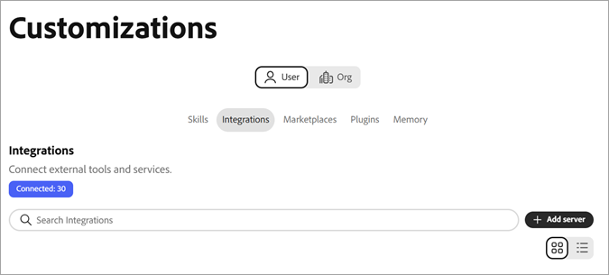

# Erste Schritte mit dem Coworker Chat {#ui-guide}

Mit dem Coworker Chat können Sie mit Ihren Adobe CX Enterprise-Daten und -Tools arbeiten, indem Sie in einfacher Sprache nachfragen, was Sie benötigen. Verwenden Sie diese Seite, um den Coworker Chat zu öffnen, Ihre erste Nachricht zu senden und Ihre Arbeitsweise einzurichten.

## Verfügbarkeit

[!DNL Coworker] [!UICONTROL Chat] ist als interaktives Erlebnis, als ganzseitiger Arbeitsbereich und als produktinternes Erlebnis in einigen [!DNL CX Enterprise]-Anwendungen verfügbar.

Die folgende Tabelle zeigt, wo die einzelnen Erlebnisse verfügbar sind.

| CX Enterprise-Anwendung | Immersive Erfahrung | Produktinternes Erlebnis |
|---|---|---|
| Real-Time CDP | Jetzt verfügbar | Demnächst |
| Adobe Journey Optimizer | Jetzt verfügbar | Demnächst |
| Customer Journey Analytics | Jetzt verfügbar | Jetzt verfügbar |
| Workfront | Jetzt verfügbar | Jetzt verfügbar |
| Target | Jetzt verfügbar | Jetzt verfügbar |
| AEM | Jetzt verfügbar | Jetzt verfügbar |
| Marketo Engage | Jetzt verfügbar | Demnächst |

## Bei [!DNL Coworker] anmelden {#sign-in}

Melden Sie sich mit Ihren Adobe-Anmeldeinformationen bei [!DNL Coworker] an.

1. [Anmelden](https://experienceleague.adobe.com/en/docs/core-services/interface/experience-cloud#sign-in-to-cx-enterprise) bei CX Enterprise mit Ihrer Adobe ID.

   Nach der Anmeldung können Sie [!DNL Coworker] über das Menü der [!DNL CX Enterprise] Anwendung oder einen direkten Link öffnen:

   * Klicken Sie in [!DNL CX Enterprise] auf das Programmauswahlmenü  und dann auf **[!DNL Coworker]**.

   * Um einen direkten Link zu verwenden, navigieren Sie zu [https://experience.adobe.com/#/coworker](https://experience.adobe.com/#/coworker).

1. Um einen Chat zu starten, klicken Sie **[!UICONTROL Neuer Chat]** in der Navigationsleiste.

## Lernen Sie die Grundlagen des Coworker Chat kennen.

>[!VIDEO](https://video.tv.adobe.com/v/3498558?learn=on)

## Angeben der Voreinstellungen für Kollegen {#preferences}

Links unten in der Benutzeroberfläche können Sie Optionen und Voreinstellungen angeben, die bestimmen, welche Daten, Fähigkeiten und verbundenen Tools ein Chat-Gespräch erreichen kann.

| Einstellung/Option | Verwenden Sie sie für folgende Zwecke: |
| --- | --- |
| Kontoname und E-Mail | Bestätigen Sie, mit welchem Adobe-Konto Sie angemeldet sind. |
| **[!UICONTROL Benachrichtigungen]** (Glockensymbol) | Anzeigen Ihrer [Benachrichtigungen](https://experienceleague.adobe.com/en/docs/core-services/interface/features/account-preferences#subscribe-to-notifications-in-experience-cloud). |
| **[!UICONTROL Design]** | Wechseln Sie zwischen den hellen und dunklen Designs. |
| **[!UICONTROL App-Einstellungen]** | Anzeigen von Kontodetails und Arbeitsbereich-Einstellungen. |
| **[!UICONTROL Voreinstellungen]** | Öffnen Sie Ihr Konto [Voreinstellungen](https://experienceleague.adobe.com/de/docs/core-services/interface/features/account-preferences). Der Pfeil zeigt an, dass die Seite außerhalb von Coworker geöffnet wird. |
| **[!UICONTROL Organisation]** | Wählen Sie die IMS[Organisation](https://experienceleague.adobe.com/de/docs/core-services/interface/administration/organizations) in der Sie arbeiten möchten. Das Menü zeigt die aktuelle Organisation an, und ein Häkchen identifiziert die ausgewählte Organisation in der Liste. |
| **[!UICONTROL Sandbox]** | Wählen Sie die Experience Platform [Sandbox](https://experienceleague.adobe.com/de/docs/experience-platform/sandbox/home), in der Sie arbeiten möchten. Im Menü werden die aktuelle Sandbox und ihr Typ angezeigt, z. B **„prod**. |
| **[!UICONTROL CX-Anwendungen]** | Wechseln Sie zu einer anderen mit Ihrem Konto verbundenen CX Enterprise-Anwendung. |
| **[!UICONTROL Abmelden]** | Melden Sie sich von Ihrem Adobe-Konto ab. |

## Einführung in die Funktionen von Coworker {#interface-features}

Coworker hat zwei Hauptbereiche: die Navigationsleiste links und das Chat-Fenster, das den Rest des Bildschirms ausfüllt. Um die Navigationsleiste so zu reduzieren, dass nur Symbole angezeigt werden, klicken Sie auf das Symbol zum Reduzieren neben dem Produktnamen.

* Navigationsleiste:

  

* Chatfenster (hier mit geöffneter Seite **[!UICONTROL Chats]** angezeigt):

  

Über die Navigationsleiste können Sie mit den folgenden Funktionen mit Kollegen chatten und zu Ihren letzten Arbeiten zurückkehren:

| Option | Verwenden Sie sie für folgende Zwecke: |
| --- | --- |
| **[!UICONTROL Neuer Chat]** | Beginnen Sie ein Gespräch. [!UICONTROL Coworker Chat] speichert Ihren aktuellen Chat in Ihrem Verlauf. |
| **[!UICONTROL Startseite]** | Kehren Sie zur Begrüßung, zum Eingabefeld und zu den vorgeschlagenen Eingabeaufforderungen zurück. |
| **[!UICONTROL Chats]** | Vergangene Unterhaltungen suchen, anheften, archivieren oder löschen. |
| **[!UICONTROL Artefakte]** | Öffnen Sie die Artefakte, die Coworker Chat in Ihren Unterhaltungen erstellt hat. |
| **[!UICONTROL Erlebniskontext]** | Verbinden Sie Coworker mit Ihren bestehenden Adobe-Anwendungen (wie Marketo Engage) und anderen Unternehmenssystemen, damit sie auf alle relevanten Kunden- und Account-Daten zugreifen und diese verstehen können. |
| **[!UICONTROL Anpassungen]** | Kenntnisse, Integrationen, Marketplaces, Plug-ins und Speicher verwalten |
| **[!UICONTROL Zuletzt verwendet]** | Öffnen Sie Ihre neuesten Unterhaltungen. Klicken Sie **[!UICONTROL Alle anzeigen]**, um die Seite „Chats“ zu öffnen. |
| **[!UICONTROL angeheftet]** | Offene Unterhaltungen, die Sie gestartet haben. Klicken Sie **[!UICONTROL Alle anzeigen]**, um sie auf der Seite „Chats“ anzuzeigen. |

## Beliebige Fragen an Coworker stellen {#message}

Auf der Startseite des -Mitarbeiters können Sie je nachdem, was der -Mitarbeiter-Chat in Ihrer Sandbox tun kann, Ihre Frage eingeben oder eine vorgeschlagene Eingabeaufforderung auswählen.

So stellen Sie einer Kollegin eine Frage:

1. [Offener Kollege](#sign-in).
1. Führen Sie einen der folgenden Schritte aus:

   * Wählen Sie eine Eingabeaufforderung unter **[!UICONTROL Empfohlen für Sie]** aus. Der Coworker Chat fügt es in das Eingabefeld ein, wo Sie es bearbeiten können.
   * Geben Sie Ihre eigene Anfrage in das Feld **[!UICONTROL Mitarbeiter nach]** fragen“ ein.

1. (Optional) Fügen Sie einen Kontext hinzu, wählen Sie aus, wie der Coworker Chat antwortet, oder diktieren Sie Ihre Nachricht. Siehe [Kontext hinzufügen und einen Antwortstil &#x200B;](#input-options).
1. Klicken Sie auf **[!UICONTROL Senden]**.

>[!TIP]
>
>Vorgeschlagene Eingabeaufforderungen zeigen die Arten von Aufgaben an, die von Coworker Chat unterstützt werden, z. B. das Verschieben von Schemas zwischen Sandboxes, das Suchen von Anomalien in einem Journey und das Validieren eines Datensatzes.

Um auf ein bestimmtes Objekt in Ihrer Sandbox zu verweisen, geben Sie **+** in das Eingabefeld ein und klicken Sie auf ein Schema, einen Journey, einen Datensatz oder ein anderes Objekt. Dies wird als Erwähnung einer Entität bezeichnet. Es sagt Coworker Chat genau, welches Objekt Sie meinen.

## Kontext hinzufügen und Antwortstil wählen {#input-options}

Die Symbolleiste unter dem Eingabefeld steuert, was Sie anhängen, wie der Coworker Chat sich der Aufgabe nähert und wie viel von ihrer Arbeit Sie sehen.

| Kontrollvariante | Verwenden Sie sie für folgende Zwecke: |
| --- | --- |
| **[!UICONTROL +]** (Anhängen) | Fügen Sie Ihrer Nachricht eine Datei oder ein Sandbox-Objekt hinzu. |
| **[!UICONTROL Planmodus]** | Lesen Sie einen schrittweisen Plan, bevor Sie im Coworker Chat agieren. |
| **[!UICONTROL Transkriptansicht]** (mit der aktuellen Ansicht beschriftet, z. B. **[!UICONTROL Normal]**) | Wählen Sie aus, wie viel von der Aktivität des Coworker Chats Sie sehen. |
| **[!UICONTROL Mikrofon]** | Diktieren Sie Ihre Nachricht. Zum Stoppen der Aufzeichnung erneut klicken. |
| **[!UICONTROL Senden]** (Pfeilsymbol) | Senden Sie Ihre Nachricht. Das Steuerelement ist erst verfügbar, wenn Sie eine Nachricht eingeben. Während der Coworker Chat antwortet, wird dieses Steuerelement zu **[!UICONTROL Stopp]**, was die Antwort unterbricht. |

### Datei oder Objekt anhängen

Hängen Sie eine Datei oder ein Objekt an, wenn der Coworker Chat weitere Informationen benötigt, um die Arbeit zu erledigen.

1. Klicken Sie im Eingabefeld auf **[!UICONTROL +]**.
1. Klicken Sie auf eine der folgenden Optionen:

   * **[!UICONTROL Datei anhängen]**: Laden Sie eine Datei für den Coworker Chat hoch, um sie zu lesen und zu referenzieren.
   * **[!UICONTROL Daten oder Objekt hinzufügen]**: Referenzieren Sie ein Objekt in Ihrer Sandbox, z. B. einen Datensatz oder ein Schema, sodass der Coworker Chat mit Ihren Live-Daten funktioniert.

### Prüfen eines Plans vor der Durchführung von Coworker Chat-Aktionen {#plan-mode}

Verwenden Sie den Planmodus für komplexe Aufgaben oder Aufgaben, die Daten ändern. Wenn der Planmodus aktiviert ist, schlägt der Coworker Chat einen Plan vor und wartet auf Ihre Genehmigung, bevor er ausgeführt wird. Wenn der Planmodus deaktiviert ist, beginnt der Coworker Chat sofort mit der Arbeit.

1. Klicken Sie **[!UICONTROL Planmodus]** in der Symbolleiste „Eingabe“, um sie zu aktivieren.
1. Senden Sie Ihre Nachricht.
1. Prüfen Sie den Plan und genehmigen Sie ihn, um fortzufahren.

### Transkriptansicht auswählen

Die Transkript-Ansicht steuert, wie viel von der Logik und der Tool-Aktivität des Kollegen-Chats in der Konversation angezeigt wird.

1. Klicken Sie in der Symbolleiste „Eingabe“ auf das Steuerelement „Transkriptansicht“. Sie zeigt die aktuelle Ansicht an, z. B **[!UICONTROL „Normal]**.
1. Auf eine Ansicht klicken:

   | Anzeigen | Was Sie sehen |
   | --- | --- |
   | **[!UICONTROL normal]** | Eine Zusammenfassung der wichtigsten Denkschritte und Tool-Aktivitäten. |
   | **[!UICONTROL Fokus]** | Meistens die Antwort. Im Coworker Chat werden die meisten Zwischenschritte ausgeblendet. |
   | **[!UICONTROL Verbose]** | Jeder denkende Schritt, jedes Laden von Kenntnissen, jedes Lesen von Dateien und jede Abfrage. |

## Überprüfen einer Antwort

Der Coworker Chat zeigt seine Arbeit, wie sie läuft, und gibt dann eine Antwort zurück. Eine Antwort kann ihre Argumentation, eine Aufzeichnung der verwendeten Tools, Artefakte und eine Zusammenfassung enthalten.

Wenn eine Antwort lang ist, klicken Sie auf den Pfeil über der Antwort, um zum Ende zu springen. Im Coworker Chat wird der folgende Hinweis unter dem Eingabefeld angezeigt: „Antworten werden mithilfe von KI generiert und können ungenau sein. Vor der Verwendung überprüfen.“ Überprüfen Sie die Antworten, bevor Sie sie bearbeiten.

### Der Aktivität folgen

Während der Coworker Chat funktioniert, können Sie verfolgen und überprüfen, was er tut. In der **[!UICONTROL Normal]**-Ansicht wird eine einzeilige Zusammenfassung der Aktivität über der Antwort angezeigt, z. B. „3 Fähigkeiten geladen, 1 Datei gelesen und 2 weitere Schritte“. Klicken Sie auf die Zusammenfassung, um sie zu erweitern, und erweitern Sie einen beliebigen Eintrag, um weitere Details anzuzeigen. Zu den Einträgen gehören:

* **Gedacht für**: Ein zusammenklappbarer Block mit der Argumentation des Kollegen-Chats und wie lange er gedauert hat.
* **Geladene Qualifikation**: Die spezialisierte Funktion, die im Coworker Chat für die Aufgabe verwendet wird.
* **Datei lesen** und **1 Abfrage ausgeführt**: Die Dateien „Coworker Chat“ und die ausgeführten Abfragen mit der jeweils benötigten Zeit.

>[!TIP]
>
>Legen Sie **[!UICONTROL Transkriptansicht]** auf **[!UICONTROL Verbose]** fest, um jeden Schritt anzuzeigen, oder auf **[!UICONTROL Focus]**, um ihn auszublenden.

### Arbeiten mit Artefakten

Das Kollegenchat zeigt Ergebnisse, wie eine Tabelle mit Zielgruppen, als Artefaktkarten in der Antwort an. Sie können ein Tabellenartefakt als CSV-Datei von seiner -Karte herunterladen. Wenn eine Antwort mehr als ein Artefakt enthält, verwenden Sie **[!UICONTROL Zurück]** und **[!UICONTROL Weiter]**, um zwischen ihnen zu wechseln.

### Verwenden der Zusammenfassung

Unter den Artefakten erklärt der Coworker Chat, was die Ergebnisse bedeuten, hebt bemerkenswerte Ergebnisse hervor und schlägt Folgemaßnahmen vor. Nutzen Sie diese Vorschläge, um das Gespräch fortzusetzen.

### Bewerten und Kopieren einer Antwort

Jede Antwort enthält Steuerelemente, mit denen Sie Feedback geben oder den Inhalt wiederverwenden können.

* Klicken Sie auf **[!UICONTROL Daumen hoch]** oder **[!UICONTROL Daumen runter]**, um die Antwort zu bewerten. Ihre Bewertung hilft, zukünftige Antworten zu verbessern.
* Klicken Sie auf **[!UICONTROL Kopieren]** und wählen Sie dann **[!UICONTROL Als Markdown kopieren]**, um die Formatierung beizubehalten, oder **[!UICONTROL Als Nur-Text kopieren]**, um sie zu entfernen.

## Chats verwalten

Ihr Chat-Verlauf speichert vergangene Unterhaltungen, damit Sie zu ihnen zurückkehren können. Klicken Sie **[!UICONTROL der]** auf „Chats“, um sie zu öffnen. Die Unterhaltungen sind nach Datum gruppiert, und jede Zeile zeigt den Titel und die Anzahl der Umdrehungen an.

Auf der Seite „Chats“ haben Sie folgende Möglichkeiten:

* Geben Sie in **[!UICONTROL Suche nach Titel]** einen Namen ein, um eine Konversation zu finden.
* Klicken Sie **[!UICONTROL Angeheftet anzeigen]**, um nur die von Ihnen gestarteten Konversationen anzuzeigen.
* Klicken Sie **[!UICONTROL Archivierte anzeigen]**, um archivierte Konversationen anzuzeigen.
* Klicken Sie **[!UICONTROL Neuer Chat]**, um ein Gespräch zu beginnen.

Um eine Konversation anzuheften, umzubenennen, zu archivieren oder zu löschen, klicken Sie auf das Zeilenmenü (**[!UICONTROL …]**) in der entsprechenden Zeile und wählen Sie eine Option aus.

## Kollegen-Chat anpassen

[!UICONTROL Anpassungen] steuern, was [!UICONTROL Coworker Chat] tun kann. Klicken Sie in **[!UICONTROL Navigationsleiste auf]** Anpassungen“ und wählen Sie dann eine Registerkarte aus: **[!UICONTROL Kenntnisse]**, **[!UICONTROL Integrationen]**, **[!UICONTROL Marketplaces]**, **[!UICONTROL Plugins]** oder **[!UICONTROL Memory]**.

### Hinzufügen und Anzeigen von Kenntnissen

Kenntnisse sind spezialisierte Funktionen, die Coworker Chat automatisch verwendet, wenn sie sich bewerben. Sie können auch selbst eine Qualifikation starten, indem Sie **/** in den Chat eingeben. Auf **[!UICONTROL Registerkarte]** Kenntnisse“ werden alle installierten Kenntnisse aufgelistet.

1. Klicken Sie auf der **[!UICONTROL Kenntnisse]** auf **[!UICONTROL Kenntnisse hinzufügen]**, um Kenntnisse aus einer neuen Quelle zu installieren.
1. Geben Sie in **[!UICONTROL Suchen]** einen Namen ein, um eine Qualifikation zu finden.
Verwenden Sie den Umschalter Ansicht , um zwischen Raster- und Listen-Layouts zu wechseln.
1. Wählen Sie eine Qualifikation aus, um das Plug-in, zu dem sie gehört, und die darin enthaltenen Dateien anzuzeigen, wenn Coworker Chat sie verwendet.

1. (Optional) Klicken Sie auf **[!UICONTROL Qualifikation anzeigen]** um die vollständige Qualifikationsdefinition zu lesen, oder klicken Sie auf **[!UICONTROL Source entfernen]** um die Qualifikation zu deinstallieren.

### Server anschließen {#server}

Eine Server-Integration verbindet den Coworker Chat mit externen Tools und Services wie Adobe Journey Optimizer, Real-Time CDP, Target und Workfront.

1. Navigieren Sie **[!UICONTROL Anpassungen]** > **[!UICONTROL Benutzer]** > **[!UICONTROL Integrationen]**

   

   Auf **[!UICONTROL Registerkarte]** Integrationen“ werden Ihre verbundenen Server und die Anzahl der aktiven Verbindungen aufgeführt. Jede Karte zeigt den Servernamen, den Endpunkt und Tags, die beschreiben, was sie bereitstellt.

1. Klicken Sie in „Anpassungen“ auf **[!UICONTROL Server hinzufügen]**.

   

1. Füllen Sie die folgenden Felder und Optionen aus:

   * **[!UICONTROL Server-Name]** (erforderlich): Geben Sie einen Namen ein, der den Server in Ihrer Integrationsliste identifiziert, z. B. `github` oder `slack`.
   * **[!UICONTROL Source-URL oder -Befehl]** (erforderlich): Geben Sie die Adresse ein, mit der sich der Coworker Chat verbindet, z. B. `https://mcp.example.com/sse`.
   * **[!UICONTROL Verbindungstyp]**: Wählen Sie das Protokoll aus, das der Server für die Kommunikation mit dem Coworker Chat verwendet, entweder **[!UICONTROL SSE]** (Server-gesendete Ereignisse) oder **[!UICONTROL HTTP]**. Der Standardwert lautet **[!UICONTROL SSE]**.
   * **[!UICONTROL Tool-Zeitüberschreitung (Sekunden)]**: Legen Sie fest, wie lange der Coworker Chat warten soll, bis ein Tool auf diesem Server reagiert, bevor er die Anfrage stoppt. Der Standardwert ist 60 Sekunden.
   * **[!UICONTROL Authentifizierung]**: Wählen Sie aus, wie der Coworker Chat dem Server seine Identität beweist. Der Standardwert ist **[!UICONTROL None]** wodurch keine Anmeldeinformationen gesendet werden. Wählen Sie eine andere Methode aus, wenn der Server Anmeldeinformationen erfordert.
   * **[!UICONTROL Kopfzeilen]**: Klicken Sie auf **[!UICONTROL Kopfzeile hinzufügen]**, um bei jeder Anfrage an den Server zusätzliche HTTP-Kopfzeilen wie einen API-Schlüssel zu senden. Diese Option ist optional.

1. Klicken Sie auf **[!UICONTROL Hinzufügen]**.

### Marketplace hinzufügen

Ein Marketplace ist eine Registrierung von Plug-ins, die Sie durchsuchen und installieren können. Klicken Sie auf der **[!UICONTROL Marketplaces]**-Registerkarte auf **[!UICONTROL Marketplace hinzufügen]**, um einen neuen zu registrieren. Verwenden Sie **[!UICONTROL Suche]** oder filtern Sie nach Gruppe, um die Liste einzugrenzen. Ein Marketplace mit dem Status **Bereit** kann über installiert werden.

### Verwalten von Plug-ins

Ein Plug-in bündelt Fähigkeiten und Server, sodass Sie sie gemeinsam installieren und verwalten können. Die **[!UICONTROL Plugins]** zeigt die installierten Plugins an.

* Klicken Sie **[!UICONTROL Marktplätze durchsuchen]**, um neue Plug-ins zu finden.
* Filtern Sie nach Marketplace, um zu sehen, woher die einzelnen Plug-ins kamen.
* Klicken Sie auf **[!UICONTROL Deinstallieren]**, um ein Plug-in und alle darin enthaltenen Elemente zu entfernen.

### Speicher verwalten

Mit dem Arbeitsspeicher können Sie Ihre Präferenzen in allen Konversationen speichern, sodass Antworten im Laufe der Zeit relevant bleiben. Verwenden Sie die Registerkarte **[!UICONTROL Speicher]**, um festzulegen, was beibehalten wird.

1. Klicken Sie **[!UICONTROL Speicher]** auf der Seite „Anpassungen“.
1. Aktivieren Sie **[!UICONTROL Speicher aktivieren]**. Schalten Sie sie aus, um zu verhindern, dass sich Benutzer über Sitzungen hinweg an den Chat erinnern.
1. Überprüfen **[!UICONTROL unter „Gespeicherte Voreinstellungen]**, was im Coworker Chat gespeichert wurde. Sie können jeden Eintrag bearbeiten, löschen oder überprüfen und Einträge nach Kategorie filtern.
1. Verwenden Sie **[!UICONTROL Speicherspeicherverlauf]**, um eine Zeitleiste der Änderungen an Ihren Erinnerungen anzuzeigen.

