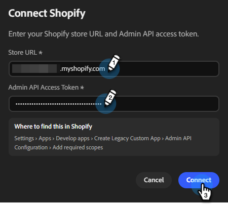

# Mit Shopify verbinden {#shopify}

Mit Coworker for Teams können Sie Ihr Shopify-Konto verbinden, um Kunden und Segmente abzurufen.

>[!PREREQUISITES]
>
>Um diesen Connector verwenden zu können, müssen Sie zunächst über Folgendes verfügen:
>
>* Ein aktives Shopify-Konto
>* Die folgende Berechtigung in Shopify: `read_customers`
>* Ihre Shopify Store-URL und [Admin-API-Zugriffstoken](https://shopify.dev/docs/apps/build/authentication-authorization){target="_blank"} praktisch

## So verbinden Sie sich

1. Klicken Sie auf der [Startseite für Teams](https://coworker-campaigns.experience.adobe.com/){target="_blank"} auf **Kontext** und wählen Sie **Connectoren**.

   

1. Klicken Sie **Integration hinzufügen**.

   

   >[!NOTE]
   >
   >Wenn dies nicht Ihre erste Integration ist, lautet die Schaltfläche „Connector hinzufügen“.

1. Klicken Sie in der Shopify-Zeile auf **Verbinden**.

   

1. Überprüfen Sie die erforderliche Berechtigung und klicken Sie auf **Weiter**.

   

1. Geben Sie Ihre Shopify **Store-URL** und Ihr **Admin-API-Zugriffstoken** ein. Klicken Sie auf **Verbinden**.

>[!NOTE]
>
>Rufen Sie in Shopify Ihr Admin-API-Zugriffstoken über **Einstellungen** › **Apps** › **Apps entwickeln** › › › **Ältere benutzerdefinierte App erstellen** **Admin-API-Konfiguration** **Erforderliche Bereiche hinzufügen** ab.

Nach dem Verbinden wird Shopify in der Liste Connectoren angezeigt.

**Verbindung trennen:**

1. Suchen Sie im Bildschirm Connectoren die Kachel Shopify und klicken Sie auf **Verwalten**.

1. Klicken Sie **Trennen** (Sie müssen Ihr Admin-API-Zugriffstoken jetzt nicht erneut eingeben).

1. Klicken Sie **zur Bestätigung erneut** Trennen“.
