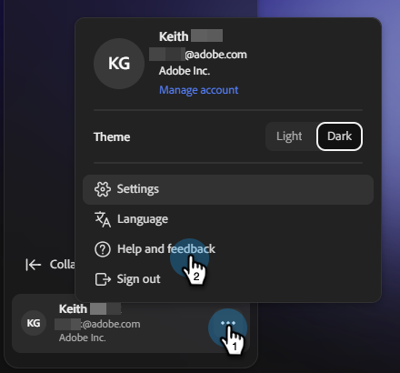

# Übersicht über Adobe CX Enterprise Coworker for Teams {#overview}

Coworker for Teams wurde für kleinere Unternehmen mit agileren Marketing-Teams entwickelt, die Content-Generierung, Journey-Erstellung und Analysen in einem einzigen Tool benötigen.

Zu diesem Zeitpunkt werden Sie bei allen Interaktionen mit der KI auf die [Kampagnenerstellung](/help/coworker-for-teams/create-an-email-campaign.md) geleitet. Weitere Funktionen folgen in Kürze.

## Zugriff

>[!NOTE]
>
>Coworker for teams ist per kostenloser Testversion bis zum 31. Dezember 2026 verfügbar. Während der Testphase sind alle Assets und Aktivitäten benutzerspezifisch.

1. Navigieren Sie zu coworker-teams.adobe.com.

1. Wenn Sie bereits über ein Adobe-Konto verfügen, klicken Sie auf **Anmelden**. Wenn nicht, klicken Sie auf **An kostenloser Testversion teilnehmen** und erstellen Sie über Ihre geschäftliche E-Mail ein Konto.

   Bestehende Adobe-Kunden werden automatisch genehmigt und direkt zur Testumgebung weitergeleitet, um die Bedingungen zu akzeptieren.

   Wenn Sie kein bestehender Kunde sind, fordern Sie Zugriff an, indem Sie **Konto erstellen** auswählen. Adobe prüft Anfragen und genehmigt geschäftliche E-Mails. Sie erhalten eine E-Mail, sobald Ihre Anfrage genehmigt wurde (überprüfen Sie unbedingt Ihren Spam-Ordner).

1. Akzeptieren Sie die Testbedingungen.

1. Richten Sie Ihre Marke unter **Ihr Material** > **Marken** ein. Ein Kollege für Teams verwendet dies als Standard für jede Kampagne, die Sie generieren.

1. (Optional) Laden Sie eine HTML-E-Mail-Vorlage unter **E-Mail-Vorlagen** hoch, damit Ihre Kollegen Ihr Design beim Generieren von Inhalten anwenden können.

   

Sie können jetzt Ihre erste Kampagne erstellen.

## Tour durch die Benutzeroberfläche

Die Benutzeroberfläche „Mitarbeiter für Teams“ ist um eine Navigation auf der linken Seite organisiert.

<table>
  <thead>
    <tr>
      <th>Linkes Navigationsmenü</th>
      <th>Zweck</th>
    </tr>
  </thead>
  <tbody>
    <tr>
      <td>Neuer Chat</td>
      <td>Neue Konversation starten, um eine Kampagne zu generieren.</td>
    </tr>
    <tr>
      <td>Startseite</td>
      <td>Ihr Ausgangspunkt: Eingabeaufforderungsleiste, letzte Kampagnen und vorgefertigte Kampagnenvorlagen.</td>
    </tr>
    <tr>
      <td>Chats</td>
      <td>Jedes von Ihnen begonnene Gespräch, das noch nicht in ein Campaign-Board generiert wurde.</td>
    </tr>
    <tr>
      <td>Kampagnen</td>
      <td>Ihr Inventar aller Entwurfs- und Live-Kampagnen.</td>
    </tr>
    <tr>
      <td>Kontaktlisten</td>
      <td>Verwalten Sie Ihre Audience und Unterdrückungslisten.</td>
    </tr>
    <tr>
      <td>Insights</td>
      <td>Anzeigen von Metriken für alle aktiven Kampagnen, verfolgt über einen ausgewählten Datumsbereich.</td>
    </tr>
    <tr>
      <td>Kontext</td>
      <td>Klicken Sie <i>Kontext</i>, um das zugehörige Untermenü anzuzeigen:  
      <ul>
      <li><b>Marken</b> - Verwalten und Hinzufügen von Marken-Kits und Festlegen eines Standardwerts für Ihren Arbeitsbereich.</li>
      <li><b>E-Mail-Vorlagen</b> - Verwalten und Hochladen benutzerdefinierter HTML-Vorlagen und teilen Sie den Teams die Verwendung der Vorlagen mit.</li>
      <li><b>Connectoren</b> - Externe Integrationen wie Databricks und Salesforce, um Zielgruppen oder Kontext einzubinden.</li>
      <li><b>Kenntnisse</b> - Wiederverwendbare Anweisungen, die bestimmen, wie ein Kollege Kampagnen erstellt und personalisiert.</li>
      </ul></td>
    </tr>
  </tbody>
</table>

>[!NOTE]
>
>Bei der Einführung konzentriert sich jedes Gespräch für Teams in Kollegen auf die Erstellung einer Kampagne. Ideen, Analysen und Support-ähnliche Gespräche werden nach und nach eingeführt.

## Was Sie mit Kollegen für Teams tun können

Ein Mitarbeiter für Teams führt fünf Workflows, die in der Regel fünf verschiedene Tools umfassen, in ein Gesprächserlebnis ein:

- **Verwandeln Sie einen Brief in eine Kampagnenstrategie**. Eingabeaufforderung ablegen oder Datei hochladen: Ein Mitarbeiter für Teams gibt eine anfängliche Strategie zur Orchestrierung Ihrer Kampagne zurück.
- **Erstellen und Verfeinern von Zielgruppen**. Laden Sie eine CSV-Datei hoch oder verbinden Sie Ihre Daten und verfeinern Sie dann das Segment in der Konversation.
- **Generieren von markeninternen Inhalten**. Mitarbeiter für Teams schreiben E-Mails, die Ihrer Markensprache, Ihren Verweisen und Vorlagen entsprechen.
- **Entwerfen Sie mehrstufige Journey**. Mitarbeiter für Teams stellen Nurture-Sequenzen zusammen, nicht nur einmalige Sendungen.
- **Testversand-E-Mails**. Zeigen Sie vor dem Start jede Nachricht in Ihrem eigenen Posteingang in der Vorschau an.
- **Starten und analysieren**. Senden Sie Kampagnen und erhalten Sie Einblicke in die nächsten besten Schritte, ohne Kollegen für Teams verlassen zu müssen.

## Funktionsweise der KI

Mitarbeiter für Teams folgen einer einfachen, mehrgängigen Gesprächsschleife:

**Eingabe**: Sie geben ein Kampagnenziel, Ihre Zielgruppe (hochgeladen oder verbunden) und den optionalen Markenkontext an.

**Verarbeitung**: Die agentische KI „Mitarbeiter für Teams“ generiert eine Kampagnenstrategie, erstellt eine Journey und entwirft personalisierte Inhalte, die Sie alle im Gespräch aktualisieren können.

**Ausgabe**: Auf Ihrem Kampagnenboard wird ein Kampagnenentwurf angezeigt, der zur Überprüfung, Iteration und schließlich zum Launch bereit ist.

Sie können jederzeit mit Kollegen für Teams sprechen (z. B. „die zweite E-Mail dringlicher gestalten“, „die Betreffzeilen verkürzen“ oder „die Zielgruppe in abgelaufene Kundinnen und Kunden aus dem 3. Quartal austauschen„), und die Artefakte werden aktualisiert.

>[!CAUTION]
>
>Die Ausgaben müssen vor dem Senden immer überprüft werden.

## Tipps für die ersten Schritte

Einige Dinge, die frühe Nutzer erkannt haben, machen einen echten Unterschied:

- **Beginnen Sie mit einem bestimmten, echten Anwendungsfall**. „Erstellen Sie eine Win-Back-Serie für Kunden, die nicht in 90 Tagen bestellt haben“ Schläge „Make me a campaign.“ Siehe [Anwendungsfälle](/help/coworker-for-teams/use-cases.md) für spezifische Beispiele.
- **Bereinigen Sie Ihre Zielgruppendaten**. Mitarbeiter für Teams können nur so personalisieren, wie es Ihre CSV-Datei erlaubt. Schließen Sie alle Kontakte aus, die Sie vor dem Hochladen nicht per E-Mail versenden sollten.
- **Investieren Sie in Ihr Markensetup**. Ein Mitarbeiter für Teams extrahiert Markendetails, wenn Sie sich anmelden. Eine kurze Übersicht über **Kontext** > **Marken** nützt jeder Kampagne, die Sie generieren.
- **Testversand per E-Mail durchführen**. Senden Sie vor dem Start einen Testversand und überprüfen Sie ihn in Ihrem eigenen Posteingang.
- **Iterieren, nicht neu starten**. Behandeln Sie die erste Ausgabe des Team-Mitarbeiters als Ausgangspunkt. Der schnellste Weg zu großem Erfolg sind ein paar Runden Verfeinerung, keine neue Eingabeaufforderung.
- **Exportieren Sie , wenn Sie eine Papierspur benötigen**. Exportieren Sie einzelne E-Mails als HTML oder die gesamte Kampagne als Word-Dokument oder PDF zur Teamüberprüfung.
- **Die Esc-Taste**. Drücken Sie die Esc-Taste jedes Mal, wenn Sie sich im Editor oder Dialogfeld eines Mitarbeiters für Teams befinden (Kampagnen, Journey usw.) um schnell zu beenden.

## Was Sie über den Prozess wissen sollten

Mitarbeiter für Teams befindet sich in der aktiven Entwicklung. Hier finden Sie Informationen zum Einstieg:

- **Testfenster**: Jetzt bis zum 31. Dezember 2026.
- **Annahme erforderlich**: Sie müssen die Testbedingungen überprüfen und akzeptieren, bevor Sie auf das Produkt zugreifen können. Eine gültige geschäftliche E-Mail-Adresse ist erforderlich.
- **Region**: Die kostenlose Testversion steht derzeit nur Nutzern in Nordamerika zur Verfügung.
- **Zielgruppen**: Zielgruppen werden über CSV hochgeladen. Alle Audiences sind spezifisch für ihre jeweiligen Kampagnen (sie werden derzeit nirgendwo anders in Ihrer Umgebung gespeichert). Wenn Sie zum Zeitpunkt der Kampagnenerstellung keine Zielgruppe haben, können Sie Kollegen für Teams bitten, eine Beispielzielgruppe zu generieren, damit Sie Ihre Kampagne weiter erstellen können.
- **Datenanleitung**: Laden Sie keine sensiblen oder regulierten Daten hoch. Coworker for Teams ist derzeit nicht für HIPAA-regulierte Branchen vorgesehen.
- **Compliance**: Sie sind für die Einhaltung von E-Mail-Vorschriften verantwortlich (Abmelde-Links, Datenschutzrichtlinien usw.).
- **Sendelimit**: Sie können bis zu 5.000 E-Mails pro Monat senden. Wenn Sie diese Beschränkung erhöhen möchten, wenden Sie sich über das Menü **Hilfe und Feedback** unten links auf dem Bildschirm an das Produkt-Team.
- **Kostenlose Subdomain**: Die Testversion enthält eine Standard-Subdomain für Ihren Arbeitsbereich, damit Sie Ihre Kampagnen schneller starten können.

## Feedback

Während der Testphase werden neue Funktionen bereitgestellt. Ihr Feedback prägt das weitere Vorgehen. Feedback senden über **Hilfe und Feedback**.
