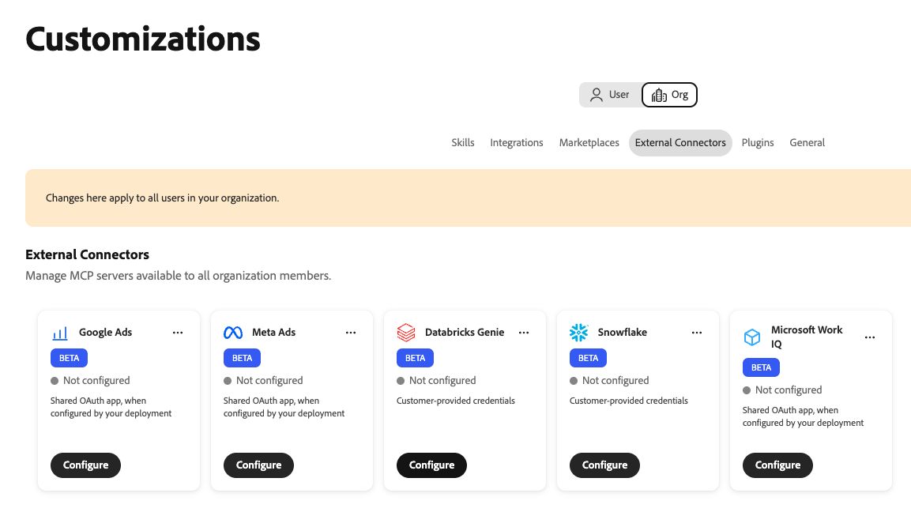
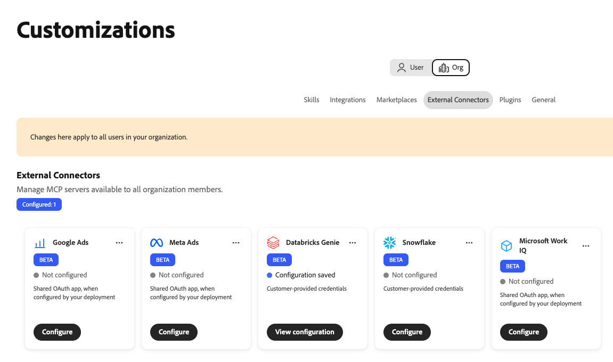
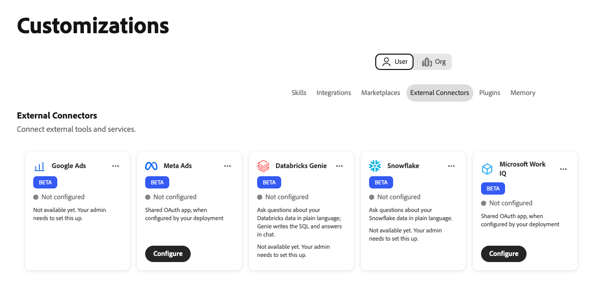

# Databricks Genie externer Connector {#databricks-genie}

Verwenden Sie den externen Connector von [!DNL Databricks Genie] , um Fragen zu Ihren [!DNL Databricks] in Adobe CX Enterprise Coworker einfach zu stellen. [!DNL Genie] schreibt die SQL und gibt die Antworten im Chat zurück. Der Connector verknüpft Coworker mit dem [!DNL Genie One] Model Context Protocol (MCP)-Server in Ihrem [!DNL Databricks] Workspace.

>[!AVAILABILITY]
>
>Der externe [!DNL Databricks Genie]-Connector befindet sich in der Beta-Phase. Die Dokumentation und die Funktionalität können sich ändern.

## Connector-Konfiguration {#connector-configuration}

Der Connector-Konfigurationsprozess besteht aus zwei separaten Teilen:

* **Einrichten einer Organisation:** Ein Administrator verbindet einen Mitarbeiter mit einem [!DNL Databricks] Arbeitsbereich, wählt aus, wie sich Personen anmelden, und wählt die Tools aus, die Mitglieder verwenden können.
* **Mitgliederzugriff:** Mitglieder verwenden die Verbindung entweder mit einer freigegebenen Organisationsidentität oder mit ihrer eigenen [!DNL Databricks] Identität, je nach der Anmeldeoption.

Der Administrator wählt eine der folgenden Anmeldeoptionen aus:

| Option | Was der Administrator bereitstellt | Funktionsweise des Zugriffs |
| --- | --- | --- |
| **[!UICONTROL Organisations-Service-Prinzipal]** | Die Client-ID und das Client-Geheimnis eines [!DNL Databricks]-Service-Prinzipals. | Alle Mitglieder verwenden die Berechtigungen des Service-Prinzipals. Mitglieder melden sich nicht bei [!DNL Databricks] an. |
| **[!UICONTROL Jede Person meldet sich an]** | Die Client-ID einer [!DNL Databricks] OAuth-App-Verbindung und ein optionales Client-Geheimnis. | Jedes Mitglied meldet sich mit seiner eigenen [!DNL Databricks] an und der Zugriff erfolgt entsprechend seinen [!DNL Databricks]. |

Keine der Optionen gewährt [!DNL Databricks] Berechtigungen, die die ausgewählte Identität noch nicht hat. [!DNL Databricks] erzwingt [!DNL Unity Catalog] Berechtigungen für jede Anfrage.

## Voraussetzungen {#prerequisites}

Dieser Connector funktioniert mit [!DNL Databricks Genie One]. Legacy-MCP-URLs für [!DNL Genie] werden nicht unterstützt. Um einen anderen [!DNL Databricks] MCP-Server, z. B. einen [!DNL Databricks SQL]-Server, zu verbinden, fügen Sie ihn separat als Integration hinzu.

Bevor Sie beginnen, stellen Sie Folgendes sicher:

* **Für die Einrichtung einer Organisation:** Ein Konto mit der Berechtigung zum Verwalten von Organisations-Connectoren in einem Kollegen.
* **Für den [!DNL Databricks]-Arbeitsbereich:** Die HTTPS-URL eines Arbeitsbereichs, in dem [!DNL Genie One] verfügbar ist.
* **Für die Option „Service-Prinzipal“** Die Client-ID und das Client-Geheimnis eines [!DNL Databricks]-Service-Prinzipals.
* **Für die Option zur persönlichen Anmeldung:** Eine [!DNL Databricks] OAuth-App-Verbindung und ihre Client-ID. Außerdem benötigen Sie einen [!DNL Databricks] Administrator, der die Umleitungs-URL für Kollegen registrieren kann.
* **Für [!DNL Databricks] Zugriff:** Workspace-, [!DNL Genie]- und Datenberechtigungen für die zu verwendende Identität. Diese Berechtigungen werden von der Arbeitskraft nicht gewährt.

>[!IMPORTANT]
>
>Geben Sie in Screenshots, Chats oder Support-Tickets niemals Kundengeheimnisse, Zugriffs-Token oder andere Anmeldeinformationen frei.

Anweisungen finden Sie in der folgenden [!DNL Databricks]-Dokumentation:

* [Genie One MCP](https://docs.databricks.com/aws/en/agents/mcp-tools/genie-mcp){target="_blank"}
* [Partner-OAuth-Anwendungen aktivieren oder deaktivieren](https://docs.databricks.com/aws/en/integrations/enable-disable-oauth){target="_blank"}
* [Autorisieren des Service-Prinzipalzugriffs auf Datenblöcke mit OAuth](https://docs.databricks.com/aws/en/dev-tools/auth/oauth-m2m){target="_blank"}

## Konfigurieren des Connectors für Ihre Organisation {#configure-organization}

Administratoren stellen den [!DNL Databricks Genie]-Connector für alle Personen in der Organisation zur Verfügung. Änderungen auf der Seite „Organisation“ gelten für alle Benutzer in Ihrer Organisation. Nur ein Organisations-Admin kann diese Verbindung hinzufügen. Mitglieder können sie nicht über die Ansicht **[!UICONTROL Benutzer]** konfigurieren.

1. Öffnen Sie **[!UICONTROL Anpassungen]**, wählen Sie **[!UICONTROL Organisation]** und dann **[!UICONTROL Externe Connectoren]** aus. Wählen Sie auf der **[!UICONTROL Databricks Genie]**-Karte **[!UICONTROL Konfigurieren]** aus.

   {width="700" zoomable="yes"}

1. Geben Sie im **[!UICONTROL Connect Databricks Genie]**-Dialog Ihre Workspace-URL oder die [!DNL Genie One] MCP-URL in **[!UICONTROL Server-URL]** ein. Die Quelle wird in folgendem Format gespeichert:

   ```text
   https://<workspace-host>/ai-gateway/mcp-services/system.ai.genie_one_mcp
   ```

   URL für den eigenen Arbeitsbereich verwenden. Der Mitarbeiter lehnt URLs ab, die kein HTTPS verwenden oder nicht unterstützte Pfade nutzen. URLs aus veralteten [!DNL Genie] wie `/api/2.0/mcp/genie/<space-id>` werden nicht unterstützt.

1. Wählen **[!UICONTROL unter „Wer meldet sich an?]** eine Anmeldeoption aus und vervollständigen Sie dann deren Einstellungen.

   {width="500" zoomable="yes"}

   * **[!UICONTROL Organisations-Service-Prinzipal]:**-Anfragen verwenden die Berechtigungen des Service-Prinzipals. Verwenden Sie diese Option für den zentral verwalteten oder automatisierten Zugriff. Mitglieder melden sich nicht bei [!DNL Databricks] an.

     | Einstellung | Beschreibung |
     | --- | --- |
     | **[!UICONTROL Service-Prinzipal-Client-ID]** | Erforderlich. Die Client-ID Ihres [!DNL Databricks]-Service-Prinzipals. Um den Service-Prinzipal einzurichten, wählen Sie **[!UICONTROL Dialogfeld die Option „Einrichten von Service-Prinzipal]** OAuth“ aus. |
     | **[!UICONTROL Service-Prinzipal-Client-Geheimnis]** | Erforderlich. Das Client-Geheimnis des Service-Prinzipals. Ein Mitarbeiter speichert die geheimen Daten sicher und verwendet sie für den Organisationsdienstprinzipal. |

   * **[!UICONTROL Jede Person meldet sich an]:** Anfragen verwenden die [!DNL Databricks] Berechtigungen jeder Person. Verwenden Sie diese Option für einen gesteuerten, benutzergesteuerten Zugriff. Jedes Mitglied autorisiert die App mit seiner eigenen [!DNL Databricks].

     | Einstellung | Beschreibung |
     | --- | --- |
     | **[!UICONTROL Umleitungs-URL]** | Schreibgeschützt. Kopieren Sie diese URL und fügen Sie sie hinzu, wenn Sie Coworker als OAuth-App-Verbindung in Ihrer [!DNL Databricks]-Kontokonsole registrieren. Anweisungen finden Sie unter **[!UICONTROL Hinzufügen einer OAuth-App]** Verbindung im Dialogfeld. Die Umleitungs-URL unterscheidet sich von Umgebung zu Umgebung, kopieren Sie sie daher immer aus dem Dialogfeld. |
     | **[!UICONTROL Client-ID der OAuth-App]** | Erforderlich. Die Client-ID, die [!DNL Databricks] nach dem Erstellen der App-Verbindung angezeigt wird. Ein Mitarbeiter verwendet sie, um jede Person an die [!DNL Databricks] Anmeldeseite zu senden. |
     | **[!UICONTROL Client-Geheimnis der OAuth-App]** | Optional. Geben Sie die geheimen Daten nur ein, wenn Sie die App-Verbindung als vertraulichen Client erstellt haben. Ohne Client-Geheimnis verwendet die App eine öffentliche Client-Konfiguration. |

   Coworker leitet die OAuth-URLs und -Bereiche aus dem Arbeitsbereich ab. Authentifizierungstyp und Verbindungsprotokoll sind fest und schreibgeschützt. Befolgen Sie den Genehmigungsprozess Ihres Unternehmens für die OAuth-App und den von ihr angeforderten Zugriff.

   >[!IMPORTANT]
   >
   >Bei einem Organisations-Service-Prinzipal handelt jeder, der diese Verbindung verwendet, mit den Berechtigungen des Service-Prinzipals.

1. Wählen Sie unter **[!UICONTROL Tools, die Benutzern zur Verfügung stehen]** die Tools aus, die Mitglieder verwenden können. Der Connector bietet die folgenden Tools, die standardmäßig alle verfügbar sind:

   | Tool | Beschreibung |
   | --- | --- |
   | `genie_ask` | Stell [!DNL Genie] eine Frage. |
   | `genie_poll_response` | Überprüfen Sie den Status einer Antwort, die noch in Bearbeitung ist. |
   | `genie_get_query_result` | Abrufen von Abfrageergebnissen. |
   | `genie_cancel_response` | Bricht eine Antwort ab. |

   Um ein Tool für alle Personen in Ihrer Organisation zu blockieren, entfernen Sie das Tag . Ein Mitarbeiter speichert entfernte Tools als Ausschlüsse für Ihre Organisation. Mindestens ein Tool muss aktiviert bleiben. Nachdem Sie ein Tool entfernt haben, wird die Option **[!UICONTROL Alle Tools wiederherstellen]** angezeigt. Wählen Sie diese Option aus, um die Ausschlüsse zu löschen und alle Tools wieder verfügbar zu machen.

   {width="500" zoomable="yes"}

   Mitglieder können nur die Werkzeuge sehen und verwenden, die Sie aktiviert lassen, und sie können die Werkzeugauswahl nicht ändern. Durch die Aktivierung eines Tools erhalten Mitglieder keine zusätzlichen [!DNL Databricks]. Die maximale Wartezeit für das Tool wurde auf 300 Sekunden festgelegt.

1. Überprüfen Sie **[!UICONTROL Zugriff und Berechtigungen]** und wählen Sie dann **[!UICONTROL Verbindung speichern]** aus. Die Karte **[!UICONTROL Databricks Genie]** zeigt **[!UICONTROL Konfiguration gespeichert]**.

   {width="700" zoomable="yes"}

   Wählen Sie **[!UICONTROL Konfiguration anzeigen]** aus, um den Arbeitsbereich, die Authentifizierung, die aktivierten Tools und die Tool-Zeitüberschreitung zu überprüfen. Wählen Sie dann **[!UICONTROL Test]** aus, um die Verbindung zu überprüfen.

   {width="700" zoomable="yes"}

Ein erfolgreicher Test bestätigt nicht, dass die ausgewählte Identität über die erforderlichen [!DNL Databricks] verfügt.

## Verwenden des Connectors als Mitglied {#use-as-member}

Nachdem ein Administrator den Connector konfiguriert hat, öffnen Sie ihn in Ihrer eigenen Ansicht **[!UICONTROL Anpassungen]**. Mitglieder können die Verbindung anzeigen und testen, sie jedoch nicht ändern oder entfernen.

1. Öffnen Sie **[!UICONTROL Anpassungen]**, wählen Sie **[!UICONTROL Benutzer]** und dann **[!UICONTROL Externe Connectoren]** aus.

1. Finde die **[!UICONTROL Databricks Genie]** Karte. Wenn Ihr Unternehmen den Connector nicht konfiguriert hat, zeigt die Karte **[!UICONTROL Nicht konfiguriert]** und **[!UICONTROL Noch nicht verfügbar. Ihr Administrator muss dies einrichten.]** Es gibt keine Schaltfläche **[!UICONTROL Konfigurieren]** für Mitglieder. Bitten Sie daher Ihren Administrator, [den Connector zu konfigurieren](#configure-organization).

   {width="700" zoomable="yes"}

1. Wenn Ihr Unternehmen einen Service-Prinzipal verwendet, wird auf der Karte **[!UICONTROL Verfügbar über Ihr Unternehmen]** angezeigt. Sie müssen sich nicht anmelden. Um die Verbindung zu überprüfen, öffnen Sie die Connector-Details und wählen Sie **[!UICONTROL Verbindung testen]** aus.

   {width="700" zoomable="yes"}

   Ein erfolgreicher Test zeigt **[!UICONTROL Verbindung erfolgreich]** und die Anzahl der verfügbaren Tools an.

   {width="700" zoomable="yes"}

1. Wenn Ihr Unternehmen die Pro-Person-Anmeldung verwendet, wird auf der Karte **[!UICONTROL Anmeldung erforderlich]** angezeigt. Öffnen Sie den Connector, starten Sie die Anmeldung und melden Sie sich mit dem vorgesehenen Konto bei [!DNL Databricks] an. Führen Sie alle erforderlichen Schritte für Single Sign-on (SSO) oder Multi-Faktor-Authentifizierung (MFA) aus.

1. Nachdem Sie zu Coworker zurückgekehrt sind, vergewissern Sie sich, dass der Connector **[!UICONTROL Verbunden“]**. Überprüfen Sie die Tools, die Ihr Administrator aktiviert hat, und wählen Sie **[!UICONTROL Verbindung testen]** aus.

Die Memberansicht ist schreibgeschützt. Darin werden der Verbindungsstatus und die Tools angezeigt, die Ihr Administrator aktiviert hat. Sie geben weder das OAuth-Client-Geheimnis der Organisation ein noch ändern Sie die Tool-Auswahl. Wenn die Verbindung fehlschlägt, werden in den Connector-Details ein Fehler und technische Details angezeigt. Kopieren Sie die technischen Details und teilen Sie sie mit Ihrem Administrator.

Ein „Verbunden“-Status garantiert keinen Zugriff auf bestimmte Daten. [!DNL Databricks] Arbeitsbereich-, [!DNL Genie]- und Datenberechtigungen sind weiterhin gültig.

## Fehlerbehebung beim Zugriff {#troubleshoot-access}

Wenn die Einrichtung, Anmeldung oder der Zugriff fehlschlägt, wenden Sie sich an Ihren Administrator, um Folgendes zu überprüfen:

| Problem | Was zu überprüfen ist |
| --- | --- |
| Die Server-URL wurde abgelehnt | Die URL verwendet HTTPS und ist entweder der Workspace-Ursprung oder die exakte [!DNL Genie One] MCP-URL. Entfernen Sie alte [!DNL Genie] und andere nicht unterstützte Pfade. |
| Die OAuth-Anmeldung schlägt fehl oder die Umleitungs-URL stimmt nicht überein | Die [!DNL Databricks] OAuth-App-Verbindung verfügt über die exakte Umleitungs-URL aus derselben Co-Worker-Umgebung. Die Client-ID und, falls verwendet, das Client-Geheimnis sind korrekt. |
| Die Verbindung zum Service-Prinzipal schlägt fehl | Die Client-ID und das Client-Geheimnis gehören zum beabsichtigten Service-Prinzipal, das Client-Geheimnis ist gültig und der Service-Prinzipal hat Zugriff auf den Arbeitsbereich. |
| Anmeldung erfolgreich, aber [!DNL Genie] Anfragen schlagen fehl | Der Mitglied- oder Service-Prinzipal verfügt über die erforderlichen Arbeitsbereich-, [!DNL Genie]- und Datenberechtigungen. Ihr Administrator kann die technischen Details und die aktivierten Tools überprüfen. |
| Ein Mitglied kann den Connector nicht sehen oder konfigurieren | Ein Administrator muss [!DNL Databricks Genie] zuerst in der Ansicht **[!UICONTROL Org]** konfigurieren. Mitglieder können diese Verbindung nicht erstellen. |
