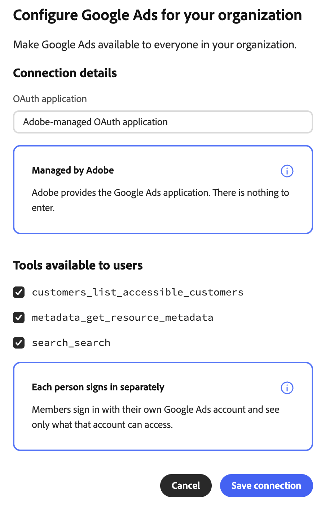
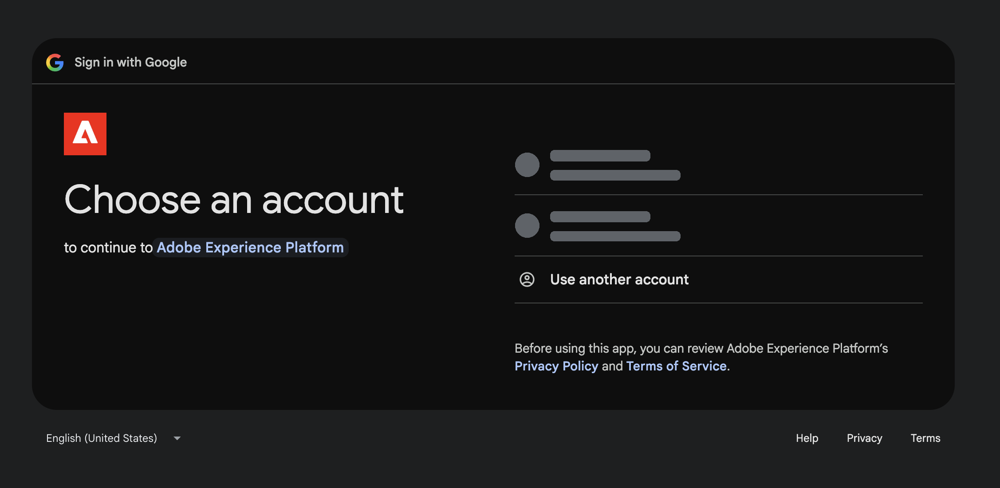

# Externer Google Ads-Connector {#google-ads}

Verwenden Sie den externen Connector [!DNL Google Ads] , um mit Ihren [!DNL Google Ads] in Adobe CX Enterprise Coworker zu arbeiten. Fragen Sie nach der Einrichtung des Connectors Ihren Kollegen, auf welche Werbekonten Sie zugreifen können, welche Felder und Metriken verfügbar sind und wie Ihre Kampagnen funktionieren. Der Connector ist ein MCP-Server (Model Context Protocol).

>[!AVAILABILITY]
>
>Der externe [!DNL Google Ads]-Connector befindet sich in der Beta-Phase. Die Dokumentation und die Funktionalität können sich ändern.

## Connector-Konfiguration {#connector-configuration}

Der Connector-Konfigurationsprozess besteht aus zwei separaten Teilen:

* **Einrichten der Organisation:** Ein Administrator konfiguriert den Connector einmal für die gesamte Organisation und wählt die Tools aus, die Mitglieder verwenden können. Adobe stellt das OAuth-Programm bereit, sodass keine App-Anmeldeinformationen eingegeben werden müssen.
* **Mitglied anmelden** Jedes Mitglied meldet sich mit seinem eigenen [!DNL Google] an. Mitglieder können nur auf die [!DNL Google Ads] Konten zugreifen, auf die ihr [!DNL Google] Konto zugreifen kann.

Beim Speichern der Organisationskonfiguration werden keine Mitglieder angemeldet und es wird auch kein Zugriff auf [!DNL Google Ads] Konten gewährt. Jedes Mitglied muss sich separat anmelden.

## Voraussetzungen {#prerequisites}

Bevor Sie beginnen, stellen Sie Folgendes sicher:

* **Für die Einrichtung einer Organisation:** Ein Konto mit der Berechtigung zum Verwalten von Organisations-Connectoren in einem Kollegen.
* **Für die Anmeldung als Mitglied:** Ein [!DNL Google] Konto mit Zugriff auf die [!DNL Google Ads] Konten, die Sie verwenden möchten.

## Konfigurieren des Connectors für Ihre Organisation {#configure-organization}

Administratoren stellen den [!DNL Google Ads]-Connector für alle Personen in der Organisation zur Verfügung. Änderungen auf der Seite „Organisation“ gelten für alle Benutzer in Ihrer Organisation.

1. Öffnen Sie **[!UICONTROL Anpassungen]**, wählen Sie **[!UICONTROL Organisation]** und dann **[!UICONTROL Externe Connectoren]** aus. Wählen Sie auf der Karte &lbrace;0 **Google Ads**&#x200B;[!UICONTROL &#x200B; die Option „Konfigurieren &#x200B;]&#x200B;**aus.**

1. Bestätigen **[!UICONTROL im Dialogfeld &quot;Google Ads für Ihr Unternehmen konfigurieren]**, dass die **[!UICONTROL OAuth-]** eine **[!UICONTROL von Adobe verwaltete OAuth-Anwendung ist]**. Adobe stellt die [!DNL Google Ads] App bereit, sodass Sie keine App-Anmeldeinformationen eingeben müssen. Wählen **[!UICONTROL unter „Für Benutzer verfügbare]**&quot; die Tools aus, die Ihr Unternehmen benötigt. Weitere Informationen finden Sie unter [Verfügbare Tools](#available-tools). Überprüfen Sie die **[!UICONTROL Jede Person meldet sich separat an]** beachten Sie dies und wählen Sie dann **[!UICONTROL Verbindung speichern]** aus.

   {width="500" zoomable="yes"}

1. Überprüfen Sie die gespeicherten **[!UICONTROL google-ads]**-Connector-Details.

   | Einstellung | Beschreibung |
   | --- | --- |
   | **[!UICONTROL Quelle]** | Die MCP Server URL für Ihre Umgebung. |
   | **[!UICONTROL Authentifizierung]** | Die Authentifizierungsmethode, `google-ads_login`. |
   | **[!UICONTROL Tool-Richtlinie]** | Die zulässigen Tool-Namen oder -Muster. |
   | **[!UICONTROL Verbindung]** | Ihr eigener Anmeldestatus. |

   {width="700" zoomable="yes"}

Der **[!UICONTROL Verbindung]**-Status in den Connector-Details bezieht sich auf Ihre eigene Verbindung, nicht auf die Organisation. Jedes Mitglied muss sich weiterhin mit seinem eigenen Konto anmelden. Nach der Anmeldung können Mitglieder &quot;**[!UICONTROL &quot; auswählen]** um die Tool-Erkennung zu testen. Um den Connector selbst zu verwenden, führen Sie die Schritte unter [Als Mitglied anmelden](#sign-in-as-a-member) aus.

Um den Connector nicht mehr für Ihre Organisation anzubieten, wählen Sie **[!UICONTROL Entfernen]** auf der Seite mit den Connector-Details aus.

### Verfügbare Tools {#available-tools}

Der [!DNL Google Ads]-Connector bietet die folgenden Tools:

| Tool | Beschreibung |
| --- | --- |
| `customers_list_accessible_customers` | Listen Sie die Kunden-IDs auf, auf die Ihr angemeldetes [!DNL Google]-Konto direkt zugreifen kann. |
| `metadata_get_resource_metadata` | Suchen Sie die Felder, Metriken und Segmente, die Sie für eine [!DNL Google Ads] Ressource verwenden können, z. B. eine Kampagne oder eine Anzeigengruppe. |
| `search_search` | Abrufen [!DNL Google Ads] Konfigurations- oder Berichtsdaten. |

## Als Mitglied anmelden {#sign-in-as-a-member}

Nachdem ein Administrator den Connector konfiguriert hat, meldet sich jedes Mitglied mit seinem eigenen [!DNL Google] an.

1. Öffnen Sie **[!UICONTROL Anpassungen]**, wählen Sie **[!UICONTROL Benutzer]** und dann **[!UICONTROL Externe Connectoren]** aus. Wählen Sie auf der Karte &lbrace;0 **Google Ads**&#x200B;[!UICONTROL &#x200B; die Option „Anmelden &#x200B;]&#x200B;**aus.**

   Wenn auf der Karte **[!UICONTROL Nicht konfiguriert]** angezeigt wird oder der Connector nicht verfügbar ist, bitten Sie Ihren Administrator, den [&#x200B; zu konfigurieren](#configure-organization).

1. Wählen Sie auf dem Bildschirm [!DNL Google] **[!UICONTROL Konto auswählen]** das Konto mit Zugriff auf Ihre [!DNL Google Ads] Konten aus oder wählen Sie **[!UICONTROL Anderes Konto verwenden]**. Führen Sie dann alle für Ihr Unternehmen erforderlichen Anmeldeschritte aus, z. B. Single Sign-on (SSO), Multifaktor-Authentifizierung (MFA) oder Identitätsüberprüfung.

   Die Schritte und ihre Reihenfolge hängen von Ihrer Organisation und Ihren Kontorichtlinien ab.

   {width="500" zoomable="yes"}

1. Überprüfen Sie das ausgewählte Konto und die App, die Sie autorisieren, und wählen Sie dann **[!UICONTROL Weiter]** aus.

   [!DNL Google] zeigt den App-Namen als [!DNL Adobe Experience Platform] an. Wenn Sie die App zuvor verwendet haben, zeigt [!DNL Google] an, dass Sie sich wieder anmelden. Erstmalige Benutzer sehen möglicherweise andere Eingabeaufforderungen.

   {width="500" zoomable="yes"}

1. Überprüfen Sie die Zugriffsanfrage und klicken Sie dann auf **[!UICONTROL Weiter]**.

   {width="500" zoomable="yes"}

   >[!IMPORTANT]
   >
   >Fahren Sie nur fort, wenn Sie die App erkennen und Ihr Unternehmen den angeforderten Zugriff genehmigt.

1. Nachdem [!DNL Google] Sie zu Coworker zurückgekehrt sind, öffnen Sie die **[!UICONTROL google-ads]**-Connector-Details. Vergewissern Sie sich, dass der Connector **[!UICONTROL Verbunden]** und **[!UICONTROL Angemeldet]** anzeigt.

   Behalten Sie **[!UICONTROL Ressourcenkennung]** den Standardwert bei, es sei denn, Ihr Administrator sagt Ihnen etwas Anderes. Dieses Feld legt die Token-Zielgruppe fest, die bei der Anmeldung gesendet wird. Um zur Standardeinstellung zurückzukehren, löschen Sie das Feld und wählen Sie **[!UICONTROL Ressourcenkennung speichern]**.

   {width="700" zoomable="yes"}

1. Wählen Sie **[!UICONTROL Test]** aus, um zu überprüfen, ob ein Mitarbeiter die Connector-Tools erkennen kann. Überprüfen Sie dann **[!UICONTROL Tools, die von Ihrem Administrator aktiviert wurden]**, um die Tools anzuzeigen, die Sie verwenden können.

   **[!UICONTROL Test]** ist nach der Anmeldung verfügbar.

   {width="700" zoomable="yes"}

Um Ihr [!DNL Google]-Konto vom Connector zu trennen, wählen Sie **[!UICONTROL Abmelden]** aus. Die Connector-Details zeigen auch die Einstellung **[!UICONTROL Tool-]**) und ein **[!UICONTROL Aktualisieren]**-Steuerelement an.

Ein **[!UICONTROL Verbunden]**-Status bestätigt nicht den Zugriff auf ein bestimmtes Werbekonto oder die erfolgreiche Ausführung jedes Berichts. Um Ihren Zugriff zu bestätigen, [überprüfen Sie den Zugriff auf Ihr Werbekonto](#check-ad-account-access).

## Überprüfen des Zugriffs auf Ihr Werbekonto {#check-ad-account-access}

Um zu bestätigen, welche [!DNL Google Ads] Konten Sie verwenden können, starten Sie einen Chat und geben Sie eine Eingabeaufforderung ein.

Beispielaufforderung:

* „Auf welche Google Ads-Konten kann ich zugreifen?“

Coworker verwendet das `customers_list_accessible_customers`-Tool, um die Kunden-IDs aufzulisten, auf die Ihr [!DNL Google]-Konto direkt zugreifen kann. Dies ist eine Kontenzugriffsüberprüfung, kein Leistungsbericht. Wenn Sie ein Manager-Konto verwenden, enthält die Liste nicht alle Konten darunter.

Bevor Sie einen Bericht anfordern, gehen Sie wie folgt vor:

* Wählen Sie ein Konto aus der Liste.
* Geben Sie einen Datumsbereich mit einem Start- und einem Enddatum an.
* Mitarbeiter bitten, die für den Bericht verfügbaren Felder und Metriken zu finden.

## Fehlerbehebung beim Zugriff {#troubleshoot-access}

Wenn Sie nicht auf Ihre [!DNL Google Ads] zugreifen können, fragen Sie bei Ihrem Administrator nach:

| Bereich | Was zu überprüfen ist |
| --- | --- |
| [!DNL Google] | Sie haben sich mit dem [!DNL Google]-Konto angemeldet, das Zugriff auf das [!DNL Google Ads]-Konto hat. |
| Kontoberechtigungen | Ihr [!DNL Google]-Konto verfügt über Berechtigungen für die [!DNL Google Ads] Konten, die Sie verwenden möchten. |
| Manager Accounts | Wenn Sie über ein Manager-Konto auf ein Konto zugreifen, hat Ihr Administrator die erforderliche Einrichtung des Manager-Kontos bestätigt. |
| Tool-Auswahl | Ihr Administrator hat die benötigten Tools unter &quot;**[!UICONTROL für Benutzer verfügbar“]**. |
| Ressourcenkennung | Die **[!UICONTROL Ressourcenkennung]** verwendet den Standardwert, es sei denn, der Administrator hat Ihnen etwas Anderes mitgeteilt. |
