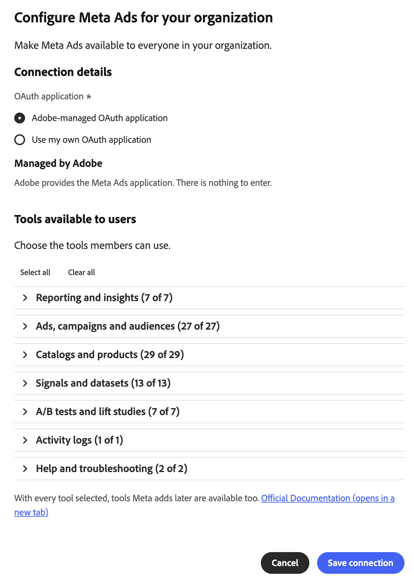
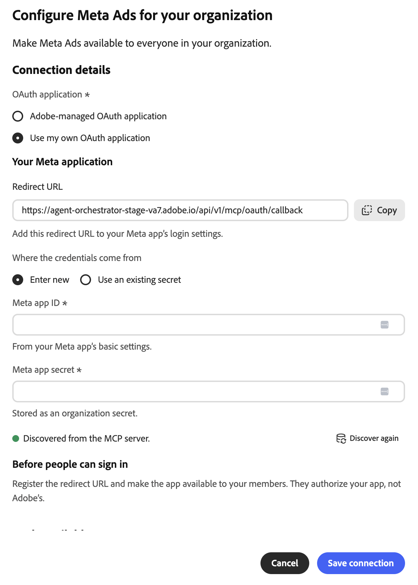

# Externer Meta Ads-Connector {#meta-ads}

Verwenden Sie den externen [!DNL Meta Ads]-Connector, um mit Ihren [!DNL Meta] Werbedaten in Adobe CX Enterprise Coworker zu arbeiten. Bitten Sie nach der Einrichtung des Connectors Ihre Kollegen, Berichte zur Anzeigenleistung zu erstellen, Kampagnen und Audiences zu verwalten, mit Produktkatalogen zu arbeiten und vieles mehr. Der Connector ist ein von [!DNL Meta] gehosteter MCP-Server (Model Context Protocol).

>[!AVAILABILITY]
>
>Der externe [!DNL Meta Ads]-Connector befindet sich in der Beta-Phase. Die Dokumentation und die Funktionalität können sich ändern.

## Connector-Konfiguration {#connector-configuration}

Der Connector-Konfigurationsprozess besteht aus zwei separaten Teilen:

* **Einrichten der Organisation:** Ein Administrator konfiguriert den Connector einmal für die gesamte Organisation. Der Administrator wählt die OAuth-Anwendung aus und wählt die Tools aus, die Mitglieder verwenden können.
* **Mitglied anmelden** Jedes Mitglied meldet sich mit seinem eigenen [!DNL Facebook] an. Mitglieder können nur auf die [!DNL Meta] Assets zugreifen, die ihre [!DNL Facebook] Identität und die autorisierte App zulassen.

Beim Speichern der Organisationskonfiguration werden keine Mitglieder angemeldet und es wird auch kein Zugriff auf Werbekonten gewährt. Jedes Mitglied muss sich separat anmelden.

## Voraussetzungen {#prerequisites}

Bevor Sie beginnen, stellen Sie Folgendes sicher:

* **Für die Einrichtung einer Organisation:** Ein Konto mit der Berechtigung zum Verwalten von Organisations-Connectoren in einem Kollegen.
* **Für die Anmeldung als Mitglied:** Ein [!DNL Facebook] mit Zugriff auf die Werbekonten, Unternehmen, Seiten oder andere [!DNL Meta] Assets, die Sie verwenden möchten.
* **Für Ihre eigene OAuth-App (optional):** Eine [!DNL Meta]-App, die Ihr Unternehmen verwaltet, zusammen mit der App-ID und dem App-Geheimnis.

## Konfigurieren des Connectors für Ihre Organisation {#configure-organization}

Administratoren stellen den [!DNL Meta Ads]-Connector für alle Personen in der Organisation zur Verfügung. Änderungen auf der Seite „Organisation“ gelten für alle Benutzer in Ihrer Organisation.

1. Öffnen Sie **[!UICONTROL Anpassungen]**, wählen Sie **[!UICONTROL Organisation]** und dann **[!UICONTROL Externe Connectoren]** aus. Wählen Sie auf der Karte {0 ]**Meta Ads**[!UICONTROL  die Option „Konfigurieren ]**aus.**[!UICONTROL 

1. Überprüfen Sie **[!UICONTROL Dialogfeld &quot;Meta Ads für Ihr]** konfigurieren“ die **[!UICONTROL Verbindungsdetails]** und wählen Sie dann eine **[!UICONTROL OAuth-Anwendung aus]**:

   * **[!UICONTROL Adobe-verwaltetes OAuth-Programm]:** Adobe stellt die [!DNL Meta Ads]-App bereit, sodass Sie keine App-Anmeldeinformationen eingeben müssen. Jedes Mitglied meldet sich nach dem Speichern weiterhin mit seinem eigenen [!DNL Facebook] an.

     {width="500" zoomable="yes"}

   * **[!UICONTROL Eigene OAuth-Anwendung verwenden]:** Ihr Unternehmen stellt eine eigene [!DNL Meta]-App bereit. Mitglieder autorisieren Ihre App, nicht die Adobe-App. Führen **[!UICONTROL unter „Ihr Meta]** Programm“ die folgenden Schritte aus:

     1. Kopieren Sie die **[!UICONTROL Umleitungs]** URL und fügen Sie sie zu den Anmeldeeinstellungen Ihrer [!DNL Meta] App hinzu. Verwenden Sie den exakten Wert, der im Dialogfeld angezeigt wird, da die Umleitungs-URL von Umgebung zu Umgebung unterschiedlich ist.
     1. Wählen Sie unter **[!UICONTROL Woher die Anmeldeinformationen kommen]** die Option **[!UICONTROL Neu eingeben]** und geben Sie dann die **[!UICONTROL Meta-App-ID]** und das **[!UICONTROL Geheimnis für die Meta-App ein]**. Die App-ID finden Sie in den Grundeinstellungen Ihrer [!DNL Meta] App. Coworker speichert das App-Geheimnis als Organisationsgeheimnis. Um stattdessen gespeicherte Anmeldeinformationen für dieselbe App wiederzuverwenden, wählen Sie **[!UICONTROL Vorhandene geheime Daten verwenden]** aus.
     1. Stellen Sie die App den Mitgliedern zur Verfügung, die sich anmelden werden. Bitten Sie Ihren [!DNL Meta]-App-Administrator, die erforderlichen Berechtigungen und alle Anforderungen für die App-Überprüfung für Ihre beabsichtigte Verwendung zu bestätigen.

     Der Indikator **[!UICONTROL Vom MCP-Server erkannt]** bestätigt, dass der Mitarbeiter den Connector gefunden hat. Es bestätigt nicht, dass Ihre App-Anmeldeinformationen gültig sind oder dass sich Mitglieder angemeldet haben. Um die Erkennung zu aktualisieren, wählen Sie **[!UICONTROL Erneut entdecken]** aus.

     {width="500" zoomable="yes"}

1. Erweitern Sie unter **[!UICONTROL Tools für Benutzer verfügbar]** jede Toolgruppe und wählen Sie die Tools aus, die Ihr Unternehmen benötigt. Um alle Tools auf einmal zu ändern, verwenden Sie **[!UICONTROL Alle auswählen]** oder **[!UICONTROL Alle löschen]**. Weitere Informationen finden Sie unter [Toolgruppen](#tool-groups). Wählen Sie dann **[!UICONTROL Verbindung speichern]**.

   {width="500" zoomable="yes"}

1. Überprüfen Sie die gespeicherten **[!UICONTROL meta-ads]**-Connector-Details. Wählen Sie optional **[!UICONTROL Test]**, um sicherzustellen, dass ein Mitarbeiter die Connector-Tools erkennen kann.

   | Einstellung | Beschreibung |
   | --- | --- |
   | **[!UICONTROL Quelle]** | Der [!DNL Meta Ads] MCP-Server, `https://mcp.facebook.com/ads`. |
   | **[!UICONTROL Authentifizierung]** | Die Authentifizierungsmethode, `meta-ads_login`. |
   | **[!UICONTROL Verbindung]** | Die verwendete OAuth-Anwendung und Ihr eigener Anmeldestatus. |
   | **[!UICONTROL Tools]** | Die für Mitglieder ausgewählten Werkzeuge mit den Steuerelementen **[!UICONTROL Alle auswählen]** und **[!UICONTROL Löschen]** und einer Anzahl ausgewählter Werkzeuge. |

   {width="700" zoomable="yes"}

Der Status **[!UICONTROL Nicht angemeldet]** in den Connector-Details bezieht sich auf Ihre eigene Verbindung, nicht auf die Organisation. Um den Connector selbst zu verwenden, wählen Sie **[!UICONTROL Anmelden]** und führen Sie die Schritte unter [Als Mitglied anmelden](#sign-in-as-a-member) aus.

Um den Connector nicht mehr für Ihre Organisation anzubieten, wählen Sie **[!UICONTROL Entfernen]** auf der Seite mit den Connector-Details aus.

### Tool-Gruppen {#tool-groups}

Der [!DNL Meta Ads]-Connector gliedert seine Tools in die folgenden Gruppen:

* [!UICONTROL Reporting und Einblicke]
* [!UICONTROL Anzeigen, Kampagnen und Audiences]
* [!UICONTROL Kataloge und Produkte]
* [!UICONTROL Signale und Datensätze]
* [!UICONTROL A/B-Tests und Lift-Studien]
* [!UICONTROL Aktivitätsprotokolle]
* [!UICONTROL Hilfe und Fehlerbehebung]

Die Gruppe &quot;[!UICONTROL  und Insights] enthält beispielsweise Tools wie `ads_insights_performance_trend` und `ads_insights_industry_benchmark`. Die Tools in den einzelnen Gruppen können sich ändern, wenn [!DNL Meta] den Connector aktualisiert.

>[!IMPORTANT]
>
>Nicht jedes Tool ist schreibgeschützt. Einige Tools können Kampagnen, Budgets, Zielgruppen, Kataloge oder andere Werbe-Assets ändern. Wählen Sie nur die Tools aus, die die Mitglieder Ihres Unternehmens verwenden möchten.

Nach dem Speichern stehen nicht ausgewählte Tools den Mitgliedern erst zur Verfügung, wenn Sie sie ausgewählt haben. Um zu bestätigen, welche Tools Mitglieder verwenden können, lesen Sie den Abschnitt **[!UICONTROL Verfügbare Tools]** auf der Seite mit den Connector-Details.

## Als Mitglied anmelden {#sign-in-as-a-member}

Nachdem ein Administrator den Connector konfiguriert hat, meldet sich jedes Mitglied mit seinem eigenen [!DNL Facebook] an. Sie benötigen kein App-Geheimnis oder Zugriffstoken, um sich anzumelden.

1. Öffnen Sie **[!UICONTROL Anpassungen]**, wählen Sie **[!UICONTROL Benutzer]** und dann **[!UICONTROL Externe Connectoren]** aus.

1. Wählen Sie auf der Karte {0 ]**Meta Ads**[!UICONTROL  die Option „Anmelden ]**aus.**[!UICONTROL 

   Wenn auf der Karte **[!UICONTROL Nicht konfiguriert]** angezeigt wird oder der Connector nicht verfügbar ist, bitten Sie Ihren Administrator, den [ zu konfigurieren](#configure-organization).

1. Melden Sie sich an, um alle erforderlichen Eingabeaufforderungen zu [!DNL Facebook] und abzuschließen, z. B. Single Sign-on (SSO), Multi-Faktor-Authentifizierung (MFA), Einverständnis oder Identitätsüberprüfung.

   Die Reihenfolge dieser Eingabeaufforderungen hängt von Ihren Konto- und Organisationsrichtlinien ab. Erstmalige -Benutzer werden möglicherweise auch aufgefordert, Berechtigungen zu erteilen und Assets auszuwählen.

1. Überprüfen Sie das [!DNL Facebook] und die App, die Sie autorisieren, und führen Sie dann einen der folgenden Schritte aus:

   * Um Ihre vorherigen Einstellungen beizubehalten, klicken Sie auf **[!UICONTROL Weiter]**.
   * Um die Autorisierung zu überprüfen oder zu ändern, wählen Sie **[!UICONTROL Einstellungen bearbeiten]** aus.
   * Um ein anderes [!DNL Facebook]-Konto zu verwenden, wählen Sie **[!UICONTROL Bei einem anderen Konto anmelden]** aus.

   Mit der von Adobe verwalteten App autorisieren Sie [!DNL Adobe Experience Cloud]. Bei Ihrer eigenen Organisations-App unterscheiden sich der App-Name und die Eingabeaufforderungen.

   {width="400" zoomable="yes"}

   >[!IMPORTANT]
   >
   >Die App erhält fortlaufenden Zugriff auf die von Ihnen freigegebenen Informationen und [!DNL Meta] Aufzeichnungen, wenn die App auf diese Informationen zugreift. Nur fortfahren, wenn Ihr Unternehmen den angeforderten Zugriff genehmigt.

1. Nachdem [!DNL Facebook] Sie zu Coworker zurückgeleitet haben, öffnen Sie die **[!UICONTROL meta-ads]**-Connector-Details. Vergewissern Sie sich, dass der Connector **[!UICONTROL Verbunden]** und **[!UICONTROL Angemeldet]** anzeigt.

   {width="700" zoomable="yes"}

1. Überprüfen Sie **[!UICONTROL Tools, die von Ihrem Administrator aktiviert wurden]**, um die Tools anzuzeigen, die Sie verwenden können.

Die Connector-Details zeigen auch die Einstellung **[!UICONTROL Tool-]**) und die folgenden Steuerelemente an:

* **[!UICONTROL Tools neu laden]:** Aktualisieren Sie die Liste der Tools.
* **[!UICONTROL Test]:** Überprüfen Sie, ob ein Mitarbeiter die Connector-Tools ermitteln kann.
* **[!UICONTROL Abmelden]:** Trennen Sie Ihr [!DNL Facebook] Konto vom Connector.

Ein **[!UICONTROL Verbunden]**-Status bestätigt nicht den Zugriff auf ein bestimmtes Werbekonto oder die erfolgreiche Ausführung jedes Tools. Um Ihren Zugriff zu bestätigen, [überprüfen Sie den Zugriff auf Ihr Werbekonto](#check-ad-account-access).

## Überprüfen des Zugriffs auf Ihr Werbekonto {#check-ad-account-access}

Um zu bestätigen, welche Werbekonten Sie verwenden können, starten Sie einen Chat und geben Sie eine schreibgeschützte Eingabeaufforderung ein.

Beispielaufforderung:

* „Auf welche Meta-Werbekonten kann ich zugreifen? Auflisten, ohne etwas zu ändern.“

Wenn Ihr Administrator das `ads_get_ad_accounts` Tool aktiviert hat, listet Coworker die Werbekonten auf, auf die Sie zugreifen können. Für jedes Konto zeigt ein Mitarbeiter das besitzende Unternehmen, die MCP-Berechtigung und die Berichtsverfügbarkeit an. Wählen Sie ein barrierefreies Konto aus, bevor Sie Berichte anfordern oder Aktionen durchführen.

## Fehlerbehebung beim Zugriff {#troubleshoot-access}

Wenn Sie nicht auf Ihre [!DNL Meta] Assets zugreifen können, überprüfen Sie Folgendes:

| Bereich | Was zu überprüfen ist |
| --- | --- |
| [!DNL Facebook] | Sie haben sich mit dem [!DNL Facebook]-Konto angemeldet, das Zugriff auf das Werbekonto hat. |
| Asset-Berechtigungen | Ihr [!DNL Facebook]-Konto verfügt über Berechtigungen für die Werbekonten, Unternehmen oder Seiten, die Sie verwenden möchten. |
| App-Autorisierung | Sie haben die App autorisiert und die erforderlichen Assets freigegeben. Um die Autorisierung zu überprüfen, melden Sie sich ab und wieder an und wählen Sie dann **[!UICONTROL Einstellungen bearbeiten]** aus. |
| Aktivierte Tools | Ihr Administrator hat die benötigten Tools unter &quot;**[!UICONTROL für Benutzer verfügbar“]**. |
| Ihre eigene OAuth-App | Die Umleitungs-URL stimmt genau überein, die App-ID und das App-Geheimnis sind korrekt, und Mitglieder haben Zugriff auf die App. Bestätigen Sie die erforderlichen Berechtigungen mit Ihrem [!DNL Meta] App-Administrator. |
