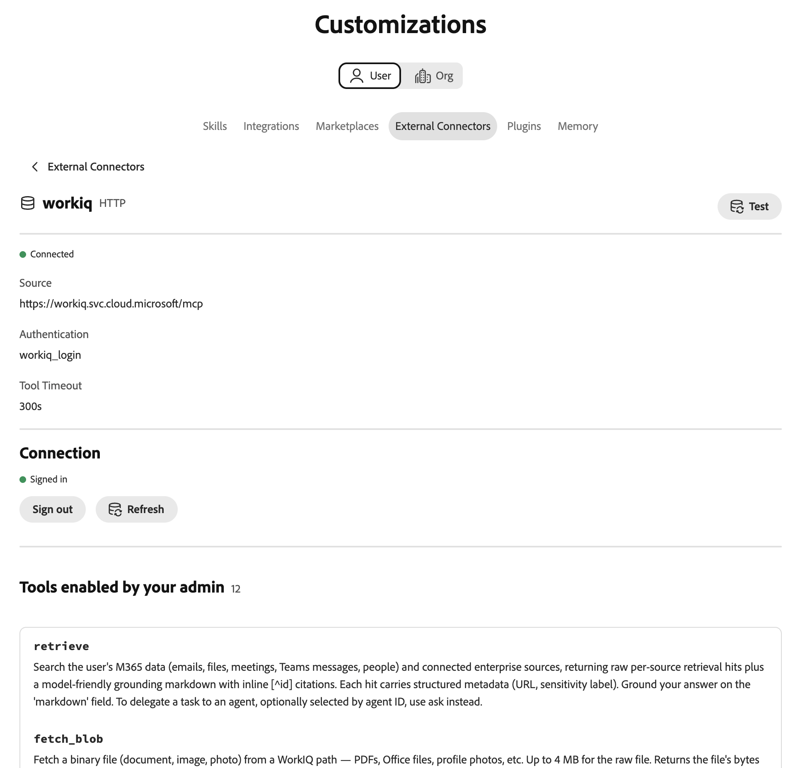

# Externer Microsoft Work IQ-Connector {#microsoft-work-iq}

Verwenden Sie den externen Connector [!DNL Microsoft Work IQ] , um mit Ihren [!DNL Microsoft 365] in Adobe CX Enterprise Coworker zu arbeiten. Bitten Sie nach der Einrichtung des Connectors einen Kollegen, Ihre E-Mail, Dateien, Meetings und [!DNL Microsoft Teams] Nachrichten zu durchsuchen, Kalenderereignisse zu überprüfen und vieles mehr. Der Connector ist ein von [!DNL Microsoft] gehosteter MCP-Server (Model Context Protocol).

>[!AVAILABILITY]
>
>Der externe [!DNL Microsoft Work IQ]-Connector befindet sich in der Beta-Phase. Die Dokumentation und die Funktionalität können sich ändern.

## Connector-Konfiguration {#connector-configuration}

Der Connector-Konfigurationsprozess besteht aus zwei separaten Teilen:

* **Einrichten der Organisation:** Ein Administrator konfiguriert den Connector einmal für die gesamte Organisation. Der Administrator verbindet eine [!DNL Microsoft Entra] App und wählt die Tools aus, die Mitglieder verwenden können.
* **Mitglieder-Anmeldung:** Jedes Mitglied meldet sich mit seinem eigenen [!DNL Microsoft]-Konto an. Mitglieder können nur auf die Daten zugreifen, auf die ihr Konto zugreifen kann.

Beim Speichern der Organisationskonfiguration werden keine Mitglieder angemeldet und es werden keine zusätzlichen [!DNL Microsoft 365] gewährt. Jedes Mitglied muss sich separat anmelden.

Auf der Karte **[!UICONTROL Microsoft Work IQ]** ist eine freigegebene OAuth-App aufgeführt, die nur verfügbar ist, wenn eine Bereitstellung konfiguriert ist. Gehen Sie nicht davon aus, dass bereits eine App bereitgestellt wurde. Auf dieser Seite wird beschrieben, wie Sie Ihre eigene [!DNL Microsoft Entra] App verbinden.

## Voraussetzungen {#prerequisites}

Bevor Sie beginnen, stellen Sie Folgendes sicher:

* **Für die Einrichtung einer Organisation:** Ein Konto mit der Berechtigung zum Verwalten von Organisations-Connectoren in einem Kollegen.
* **Für die [!DNL Microsoft Entra]-App:** Ein [!DNL Microsoft Entra], der eine Web-App registrieren und die Zustimmung des Administrators erteilen kann.
* **Für Ihren [!DNL Microsoft]:** [!DNL Work IQ] für den Mandanten aktiviert.
* **Für die Anmeldung als Mitglied:** Ein berechtigtes [!DNL Microsoft]-Arbeitskonto mit Zugriff auf die Daten, die Sie verwenden möchten.

## Konfigurieren des Connectors für Ihre Organisation {#configure-organization}

Administratoren stellen den [!DNL Microsoft Work IQ]-Connector für alle Personen in der Organisation zur Verfügung. Änderungen auf der Seite „Organisation“ gelten für alle Benutzer in Ihrer Organisation.

1. Öffnen Sie **[!UICONTROL Anpassungen]**, wählen Sie **[!UICONTROL Organisation]** und dann **[!UICONTROL Externe Connectoren]** aus. Wählen Sie auf der Karte **[!UICONTROL Microsoft Work IQ]** die Option **[!UICONTROL Konfigurieren]** aus.

1. Überprüfen **[!UICONTROL im Dialogfeld &quot;Microsoft Work IQ für Ihr]** konfigurieren“ die **[!UICONTROL Server-URL]**, `https://workiq.svc.cloud.microsoft/mcp`. Bereiten Sie dann Ihre [!DNL Microsoft Entra] App vor. Wählen Sie für die [!DNL Microsoft] im Dialogfeld die Option **[!UICONTROL Microsoft-]** aus.

   1. Registrieren Sie eine Web-App in [!DNL Microsoft Entra] oder verwenden Sie eine vorhandene.
   1. Kopieren Sie die **[!UICONTROL Umleitungs-URL]** aus dem Dialogfeld und registrieren Sie diesen genauen Wert als Web-Umleitungs-URI in der App. Die Umleitungs-URL unterscheidet sich von Umgebung zu Umgebung, kopieren Sie sie daher immer aus dem Dialogfeld.
   1. Erstellen Sie ein Client-Geheimnis oder bestätigen Sie, dass das vorhandene Client-Geheimnis weiterhin gültig ist. Sie benötigen den geheimen Wert, nicht die geheime ID.
   1. Erteilen Sie die Zustimmung des Administrators zur delegierten `WorkIQAgent.Ask` und bestätigen Sie, dass [!DNL Work IQ] für Ihren Mandanten aktiviert ist.

   Geben Sie unter **[!UICONTROL Microsoft Entra]** Mandanten-IDs Ihre Mandanten-ID ein. Suchen Sie in [!DNL Microsoft Entra] diesen Wert unter **[!UICONTROL Übersicht]** > **[!UICONTROL Directory (tenant) ID]**.

   {width="500" zoomable="yes"}

1. Wählen **[!UICONTROL unter „Woher die Anmeldeinformationen kommen]** eine der folgenden Optionen aus:

   * **[!UICONTROL Neu eingeben]:** Geben Sie in **[!UICONTROL OAuth-App-Client-ID]** die Anwendungs-(Client-)ID Ihrer [!DNL Microsoft Entra]-App ein. Geben **[!UICONTROL unter „Client-Geheimnis der OAuth]** App“ den geheimen Wert ein. Ein Mitarbeiter speichert den geheimen Wert als Organisationsgeheimnis.
   * **[!UICONTROL Vorhandene geheime Daten verwenden]:** Wählen Sie unter **[!UICONTROL Geheime Daten, die die Client-ID]**, und **[!UICONTROL Geheime Daten, die das Client-Geheimnis]**, die gespeicherten Organisationsgeheimnisse für Ihre App aus. Wenn die richtigen geheimen Daten nicht verfügbar sind, wählen Sie stattdessen **[!UICONTROL Neu eingeben]** aus. Sie geben die Mandanten-ID dennoch separat ein.

   Die Mandanten-ID, die Client-ID und das Client-Geheimnis müssen alle zur selben App und zum selben Mandanten gehören. Wenn Sie gespeicherte geheime Daten wiederverwenden, vergewissern Sie sich, dass das Client-Geheimnis nicht abgelaufen ist. Diese Anmeldeinformationen für die App unterscheiden sich von den [!DNL Microsoft] Kennwörtern, mit denen sich Mitglieder anmelden.

   {width="500" zoomable="yes"}

1. Wählen **[!UICONTROL unter „Für Benutzer verfügbare]**&quot; die Tools aus, die Ihr Unternehmen benötigt. Weitere Informationen finden Sie unter [Verfügbare Tools](#available-tools). Überprüfen Sie **[!UICONTROL Zugriff und Berechtigungen]**, um zu bestätigen, dass sich jede Person separat anmeldet, und wählen Sie dann **[!UICONTROL Konfiguration speichern]** aus.

   {zoomable="yes"}

1. Überprüfen Sie die gespeicherten **[!UICONTROL workiq]**-Connector-Details. Wählen Sie optional **[!UICONTROL Test]**, um sicherzustellen, dass ein Mitarbeiter die Connector-Tools erkennen kann. Informationen zum Ändern der Werkzeuge nach dem Speichern finden Sie unter [Ändern der Werkzeugauswahl](#change-tool-selection).

   | Einstellung | Beschreibung |
   | --- | --- |
   | **[!UICONTROL Quelle]** | Der [!DNL Work IQ] MCP-Server, `https://workiq.svc.cloud.microsoft/mcp`. |
   | **[!UICONTROL Authentifizierung]** | Die Authentifizierungsmethode, `workiq_login`. |
   | **[!UICONTROL Tool-Zeitüberschreitung]** | Die Tool-Zeitüberschreitung für den Connector. |
   | **[!UICONTROL Verbindung]** | Ihr eigener Anmeldestatus. |

   {width="500" zoomable="yes"}

Der Status **[!UICONTROL Nicht angemeldet]** in den Connector-Details bezieht sich auf Ihre eigene Verbindung, nicht auf die Organisation. Um den Connector selbst zu verwenden, wählen Sie **[!UICONTROL Anmelden]** und führen Sie die Schritte unter [Als Mitglied anmelden](#sign-in-as-a-member) aus.

Um den Connector nicht mehr für Ihre Organisation anzubieten, wählen Sie **[!UICONTROL Entfernen]** auf der Seite mit den Connector-Details aus.

### Verfügbare Tools {#available-tools}

Der [!DNL Microsoft Work IQ]-Connector bietet die folgenden Tools:

| Tool | Beschreibung |
| --- | --- |
| `search_paths` | Finden Sie heraus, welche [!DNL Microsoft 365] Funktionen verfügbar sind und wie Sie darauf reagieren können. |
| `get_schema` | Anzeigen, welche Felder eine unterstützte Anfrage akzeptiert oder zurückgibt. |
| `list_agents` | Anzeigen der für Ihr Konto verfügbaren [!DNL Microsoft 365 Copilot]-Agenten, ohne sie auszuführen. |
| `fetch` | [!DNL Microsoft 365] Elemente lesen, auf die Ihr Konto zugreifen kann, z. B. Nachrichten, Ereignisse, Dateien und Personen. Ändert keine Daten. |
| `call_function` | Ergebnisse aus Daten berechnen, auf die Ihr Konto zugreifen kann, z. B. eine Kalenderansicht oder aktuelle Änderungen. Ändert keine Daten. |
| `retrieve` | Durchsuchen Sie Ihre E-Mail, Dateien, Meetings, [!DNL Microsoft Teams], Personen und verbundenen Quellen mit Links zu jeder Quelle. |
| `fetch_blob` | Herunterladen einer Datei, z. B. eines Dokuments, Bildes oder Profilbilds, mit bis zu 4 MB. Ändert keine Daten. |
| `ask` | Fragen Sie [!DNL Microsoft 365 Copilot] oder einen seiner Agenten nach E-Mail, Besprechungen, Dateien und anderen [!DNL Microsoft 365]. |
| `delete_entity` | Löschen eines [!DNL Microsoft 365], z. B. einer Nachricht oder eines Ereignisses. Ändert Daten. |
| `do_action` | Ausführen einer [!DNL Microsoft 365] Aktion, z. B. Senden von E-Mails oder Verschieben eines Elements. Ändert Daten. |
| `create_entity` | Erstellen Sie ein [!DNL Microsoft 365], z. B. ein Ereignis oder einen Nachrichtenentwurf. Ändert Daten. |
| `update_entity` | Ändern eines vorhandenen [!DNL Microsoft 365], z. B. eines Ereignisses oder eines Kontakts. Ändert Daten. |

>[!IMPORTANT]
>
>Die `delete_entity`-, `do_action`-, `create_entity`- und `update_entity`-Tools ändern Daten in [!DNL Microsoft 365]. Überprüfen Sie diese Tools sorgfältig und wählen Sie nur die Tools aus, die Ihre Organisation für Ihre Mitglieder verwenden möchte.

Tools, die der Server später hinzufügt, bleiben deaktiviert, bis Sie sie auswählen.

### Werkzeugauswahl ändern {#change-tool-selection}

Um die Tools zu ändern, die den Mitgliedern nach dem Speichern zur Verfügung stehen, verwenden Sie den Abschnitt **[!UICONTROL Tools]** auf der Seite mit den Connector-Details.

1. Wählen oder löschen Sie einzelne Tools oder verwenden Sie **[!UICONTROL Alle auswählen]** oder **[!UICONTROL Löschen]**.

1. Wählen Sie **[!UICONTROL Werkzeugauswahl speichern]**.

>[!CAUTION]
>
>Wenn Sie **[!UICONTROL Alle Werkzeuge anzeigen]** wählen, wird die aktuelle Auswahl gelöscht. Mitglieder können dann jedes Tool verwenden, das von der Richtlinie nicht ausgeschlossen wird, bis Sie eine neue Auswahl speichern. Wählen Sie nicht **[!UICONTROL Alle Werkzeuge anzeigen]**, um die Liste der Werkzeuge anzuzeigen.

## Als Mitglied anmelden {#sign-in-as-a-member}

Nachdem ein Administrator den Connector konfiguriert hat, meldet sich jedes Mitglied mit seinem eigenen [!DNL Microsoft] Arbeitskonto an. Sie benötigen das Client-Geheimnis der App nicht, um sich anzumelden.

1. Öffnen Sie **[!UICONTROL Anpassungen]**, wählen Sie **[!UICONTROL Benutzer]** und dann **[!UICONTROL Externe Connectoren]** aus.

1. Wählen Sie auf der Karte **[!UICONTROL Microsoft Work IQ]** die Option **[!UICONTROL Anmelden]** aus.

   Wenn auf der Karte **[!UICONTROL Nicht konfiguriert]** angezeigt wird oder der Connector nicht verfügbar ist, bitten Sie Ihren Administrator, den [&#x200B; zu konfigurieren](#configure-organization).

1. Wählen Sie auf dem [!DNL Microsoft] **[!UICONTROL Konto auswählen]** das Arbeitskonto für Ihr Unternehmen aus oder wählen Sie **[!UICONTROL Anderes Konto verwenden]**.

   Ihr Browser speichert möglicherweise mehrere Konten, einschließlich Konten von anderen Mandanten. Das bereits angemeldete Konto ist nicht immer das richtige. Wählen Sie das Konto mit dem [!DNL Microsoft 365] Zugriff aus, den Sie benötigen.

   {width="400" zoomable="yes"}

1. Führen Sie die Anmeldeschritte für Ihr Konto aus, z. B. ein Kennwort, einmaliges Anmelden (SSO), kennwortlose Anmeldung, Multifaktor-Authentifizierung (MFA) oder andere Verifizierungen.

   Geben Sie Ihre [!DNL Microsoft] Anmeldedaten nur im Anmeldefluss ein, den Ihr Unternehmen genehmigt. Geben Sie sie niemals in die OAuth-App-Felder des Connectors ein.

   {width="400" zoomable="yes"}

1. Wenn [!DNL Microsoft] um Zustimmung bittet, überprüfen Sie die Anfrage.

   >[!IMPORTANT]
   >
   >Fahren Sie nur fort, wenn Sie die App erkennen und Ihr Unternehmen den angeforderten Zugriff genehmigt.

1. Nachdem [!DNL Microsoft] Sie zu Coworker zurückgeleitet haben, öffnen Sie die **[!UICONTROL workiq]**-Connector-Details. Vergewissern Sie sich, dass der Connector **[!UICONTROL Verbunden]** und **[!UICONTROL Angemeldet]** anzeigt.

   {width="700" zoomable="yes"}

1. Überprüfen Sie **[!UICONTROL Tools, die von Ihrem Administrator aktiviert wurden]**, um die Tools anzuzeigen, die Sie verwenden können.

Über die Connector-Details können Sie auch Folgendes tun:

* **[!UICONTROL Test]:** Überprüfen Sie, ob ein Mitarbeiter die Connector-Tools ermitteln kann.
* **[!UICONTROL Abmelden]:** Trennen Sie Ihr [!DNL Microsoft] Konto vom Connector.

Die Connector-Details zeigen auch die Einstellung **[!UICONTROL Tool-]**) und ein **[!UICONTROL Aktualisieren]**-Steuerelement an.

Der Status **[!UICONTROL Verbunden]** bestätigt nicht, dass Sie auf alle [!DNL Microsoft 365] Ressourcen zugreifen können oder dass jedes Tool erfolgreich ausgeführt wird. Um Ihren Zugriff zu bestätigen, [überprüfen Sie Ihren Zugriff auf Microsoft 365](#check-access).

## Überprüfen des Microsoft 365-Zugriffs {#check-access}

Um zu bestätigen, dass der Connector Ihre Daten lesen kann, starten Sie einen Chat und geben Sie eine schreibgeschützte Eingabeaufforderung ein.

Beispielaufforderung:

* „Finde meine Meetings für morgen und verweise auf die Quellen. Erstellen, aktualisieren, senden und löschen Sie nichts.“

Damit diese Eingabeaufforderung funktioniert, muss Ihr Administrator ein Tool aktivieren, das Kalenderdaten lesen kann, und Ihr Konto muss Zugriff auf die Daten haben.

## Fehlerbehebung beim Zugriff {#troubleshoot-access}

Wenn die Anmeldung oder der Zugriff fehlschlägt, wenden Sie sich an Ihren Administrator, um Folgendes zu überprüfen:

| Bereich | Was zu überprüfen ist |
| --- | --- |
| [!DNL Microsoft] | Sie haben sich mit dem richtigen Arbeitskonto für den gewünschten Mandanten angemeldet. |
| [!DNL Work IQ] Verfügbarkeit | [!DNL Work IQ] ist für Ihren [!DNL Microsoft] aktiviert. |
| Umleitungs-URI | Die [!DNL Microsoft Entra]-App verfügt über die exakte Umleitungs-URL aus dem Dialogfeld, das als Web-Umleitungs-URI registriert ist. |
| Einverständnis des Administrators | Ein Administrator hat die Zustimmung des Administrators für die delegierte `WorkIQAgent.Ask` erteilt. |
| Client-Geheimnis | Das Client-Geheimnis ist nicht abgelaufen, und der Connector verwendet den geheimen Wert, nicht die geheime ID. |
| Gespeicherte Geheimnisse | Beide ausgewählten Unternehmensgeheimnisse gehören zur beabsichtigten [!DNL Microsoft Entra]-App. |
| Tool-Auswahl | Wenn nur ein Tool fehlschlägt, hat Ihr Administrator dieses Tool aktiviert. |
| Berechtigungen [!DNL Microsoft 365] | Ihr Konto ist berechtigt, auf die angeforderten Daten zuzugreifen. |
